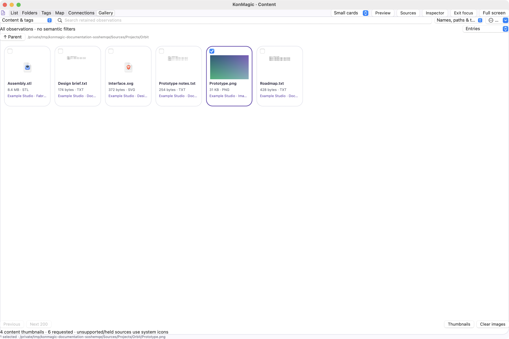
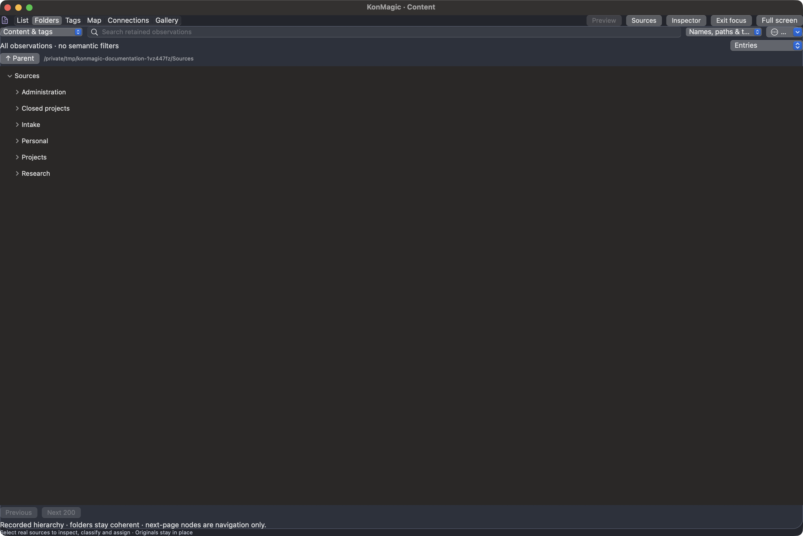
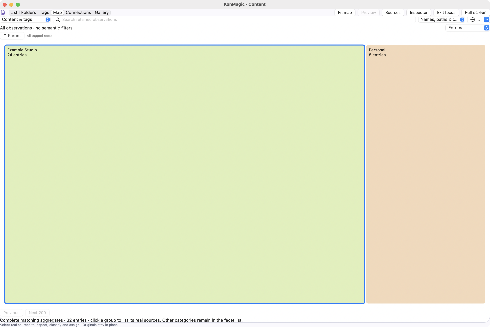
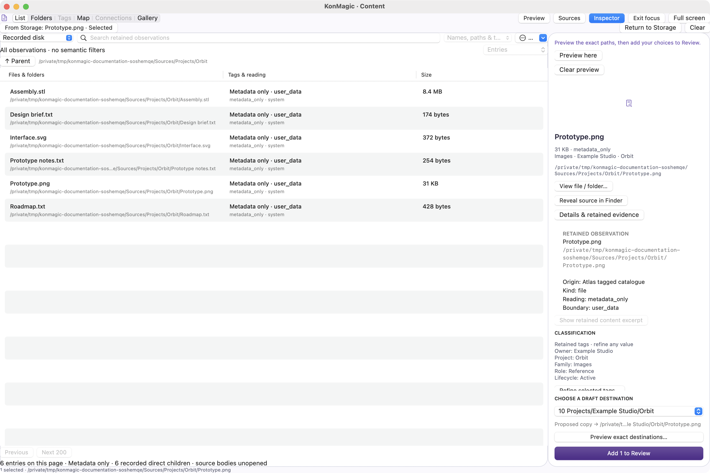
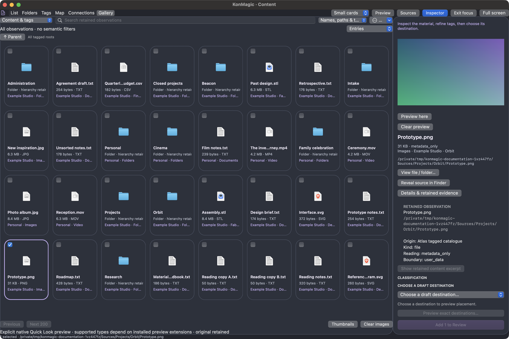

# Find and understand retained content

Content Explorer joins classifications, provenance and retained readings with exact source paths. It offers three datasets: **Content & tags**, **Recorded disk** and **Access exceptions**. They are overlapping observations with different coverage; adding their counts does not count unique files on the machine.

<figure markdown>

<figcaption>A bounded list uses 200-row pages. Complete aggregate groups remain available for narrowing the view.</figcaption>
</figure>

## An edge-to-edge discovery workspace

Choose **Focus content** (Shift-Command-M) to give the results the full window. Compact search, the dataset chooser and all six views stay visible. **Sources** and **Inspector** restore their rails independently; **Full screen** uses the native macOS window mode. The **More** menu retains collections, rules, refresh, clear filters and the illustrated guide.

| Control | Result |
|---|---|
| List / Folders / Tags / Map / Connections / Gallery | Switch the current retained slice; unchanged pages and aggregates are reused |
| Option-Command-1 through 6 | Switch visualization |
| Command-F | Focus the retained-observation search |
| Sources / Inspector | Independently toggle semantic navigation and source/classification/placement details |
| Small cards / Comfortable / Large cards | Change gallery density; columns adapt to available width |
| Pinch / two-axis scroll in a map | Magnify and pan the semantic map, 1–8× |
| Fit map | Restore the entire current semantic map |
| Gallery arrows / Shift-arrows | Navigate exact sources / extend selection |
| Gallery Return / Space | Explore a folder or explicitly request a source preview |

Physical and tag trees retain separate roots, expansion and scroll state across view switches. At most 256 expanded nodes are remembered; child pages remain bounded. Physical trees show retained hierarchy; semantic intersections apply to lists and maps. Maps and tag groups filter sources and carry no source-assignment authority.

## Continue from Storage

Select a real file or folder in Storage and choose **Explore content**. Content carries the exact source into a visible **From Storage** pin and opens its physical scope. A file uses its parent folder; a folder remains its own assignable bucket while its children can be browsed. The pin remains usable even when the selected source falls beyond the current 200-row page. A matching retained catalogue observation supplies semantic evidence; otherwise the retained scan metadata remains explicitly identified.

Choose the pin to inspect it again, or select another visible source. Refine tags, choose a destination, preview exact paths, then add the choice to Review. Maps and tag groups hold pinned source actions. A changed search, semantic filter, dataset or physical scope clears the handoff. **Return to Storage** restores the physical observation without changing original files.

## Names, paths and indexed content

Choose a familiar location or All retained content, then search. **Names, paths & tags** matches retained metadata. **Indexed content** searches the existing catalogue’s FTS index, including eligible canonical/shared readings. It does not open every original document. Operator-looking terms are treated as literal tokens rather than raw SQL or FTS syntax.

Semantic facets include owner, project, family, role and lifecycle. Additional dimensions cover reading state, barrier, kind, extension, modification year, size, confidence and method. Choose a group, combine filters and remove an individual chip without losing the others.

<figure markdown>

<figcaption>Context distinguishes family memories from a film collection even when both have a video extension.</figcaption>
</figure>

## Inspect evidence before assigning

The inspector shows retained classification and provenance, current metadata where accessible, a proposed destination, and explicit protections. The current metadata check does not establish that a body has been read or its bytes have been hashed. A catalogue row can outlive its original source; fresh verification is required later.

<figure markdown>

<figcaption>Selection exposes exact context. Destination selection previews placement before assignment.</figcaption>
</figure>

**Read retained excerpt** decodes an already cached reading, within compression and presentation bounds. It does not read the original file. Credential and audit barriers remain refused even when a body is cached; your semantic tag corrections cannot remove a protection barrier.

<figure markdown>

<figcaption>The displayed reading is invented text stored in the synthetic catalogue, not a fresh source-body ingestion.</figcaption>
</figure>

**Preview** or **Preview here** explicitly loads one eligible file into the inspector’s native Quick Look viewer. The macOS preview providers determine supported PDF, image, document, audio, video and model formats. Playback does not auto-start. **Clear preview** releases content and thumbnail requests; changing source or leaving Content releases obsolete inline content. Browsing and selection do not request original bodies.

**View file / folder…** opens the native current-source viewer. Unlike a retained excerpt, this is an explicit request to view an eligible original file. Folder selection remains metadata only until a file or thumbnail request. [Rich previews](previews.md).

## Recorded disk and access exceptions

Recorded disk reads compressed directory blocks and aliases from the ledger. Browse its physical hierarchy or a bounded direct-child page. A recorded folder that was not scanned remains an explicit exception; the app does not invent its contents. The Access exceptions dataset makes traversal and permission gaps reviewable.

<figure markdown>

<figcaption>Recorded metadata coverage is separate from semantic and reading coverage.</figcaption>
</figure>

To place a real source, choose an explicit destination, inspect its full proposed path, and assign. The app carries the exact choice into Review. Edit destinations returns to Structure with the selected destination highlighted, while Back retains the discovery context.

## Gallery and focused inspector

<figure markdown>

<figcaption>Thumbnails appear only after a request. Selection retains the exact source, tags and proposed destination.</figcaption>
</figure>

**Gallery** shows up to 200 exact observations as selectable cards with system icons, retained sizes, and owner/family context. Checkboxes support multiple selections; selecting a card updates the same source authority as List. Physical folders stay buckets. Semantic maps keep hidden source selections disabled.

Only visible rows and adjacent rows have native cards. Scrolling reaches every source on the page, while returning to an unchanged gallery reuses its cards. Type icons use retained metadata; original custom icons and thumbnails are not requested by ordinary browsing.

**Thumbnails** explicitly requests eligible current source contents through macOS providers. It handles at most three requests concurrently, holds protected/cloud/linked sources and files over 128 MiB, and times out each request after 15 seconds. Images stay in memory. Changing the page/scope, leaving Content, or **Clear images** cancels requests and releases representations. Unsupported files keep icons.

The right inspector summarizes the exact retained source and supported thumbnail. **Details & retained evidence** expands the technical observation; **View file / folder…** opens the full native viewer. Camera, GPS, similarity and duplicate proof are not inferred from a filename or illustrative mock.

## A continuous discovery journey

Select real sources, inspect the evidence, then use **Refine selected tags**. The editor offers existing semantic values and accepts your own text. It explains exactly how many categories and sources change. Saving preserves selected sources that still match the current page and preserves your chosen destination. If a changed classification removes a source from the active filter, the view explains this rather than keeping a hidden selection actionable.

Loading and empty states keep the next step explicit. While a query changes the page, old source actions are held. No-match views offer a clear-search/filter action. Classification is held during verification/copy and stale cross-window edits are refused.

The destination controls remain below the independently scrolling inspector. **Preview exact destinations** shows every selected source and target, retaining existing output names and whole-folder hierarchy. **Add selection to Review** edits only the draft and selects those sources in Review. Back returns to your discovery context. Oversized selections explain the 100-assignment draft limit while keeping their path preview available. Gallery collections can be saved and reopened.

<figure markdown>

<figcaption>This calculation does not open source bodies, create output folders or approve copying. Review performs fresh verification separately.</figcaption>
</figure>
