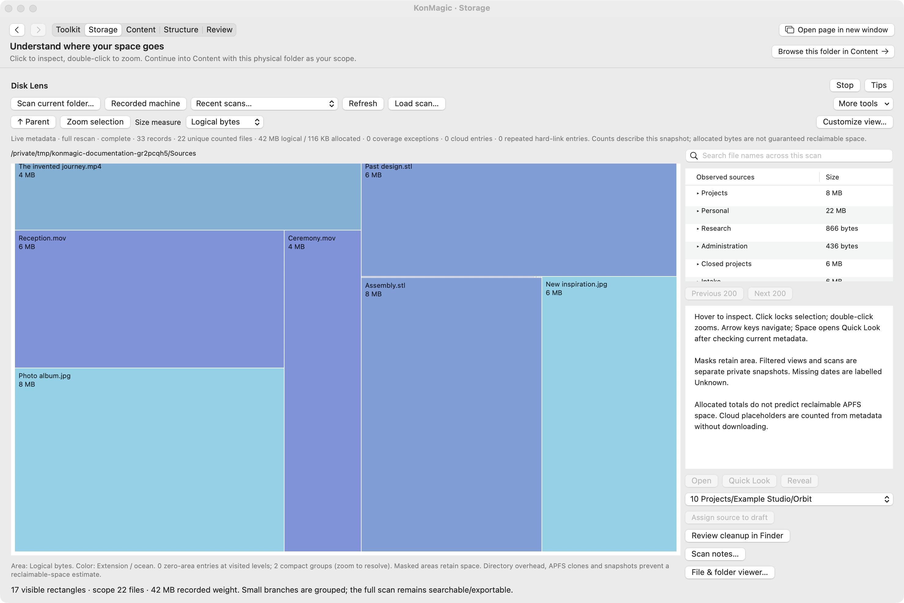
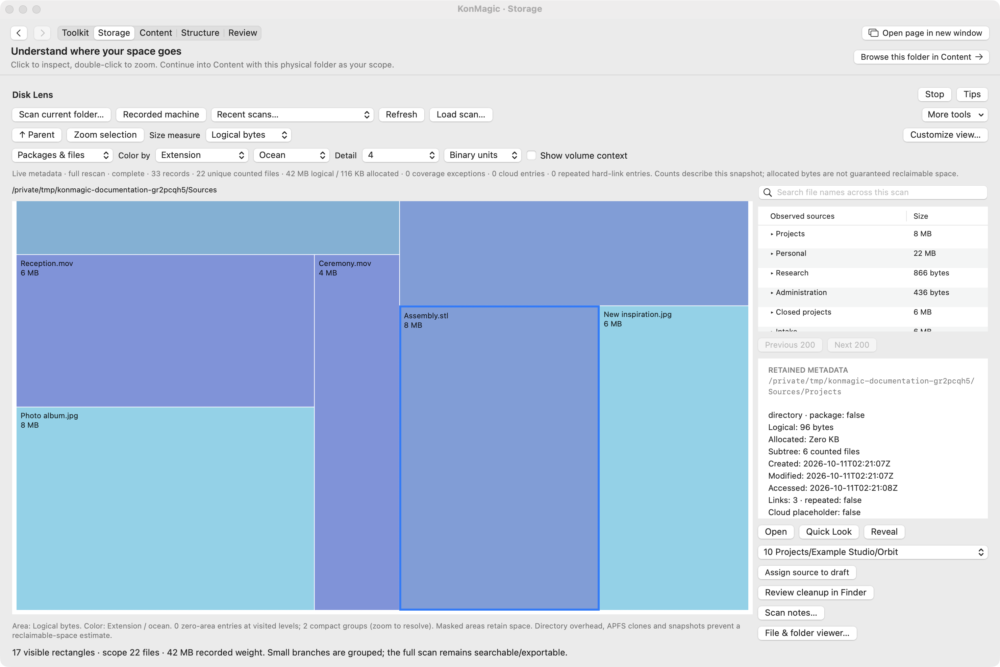
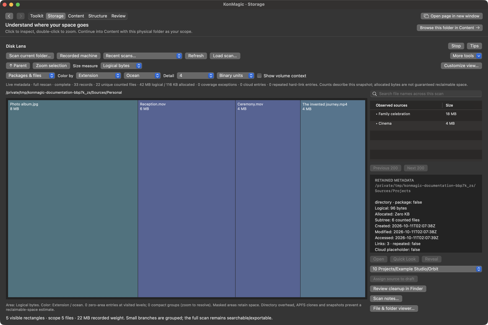

# Understand storage with Disk Lens

Storage presents a physical tree as a proportional treemap. The retained scan, its root, status, exceptions and totals are explicit. A rectangle represents recorded weight under the selected measure, not a deletion recommendation.

<figure markdown>

<figcaption>Logical size emphasizes large sparse synthetic media examples. Native metadata scanning does not read their bodies.</figcaption>
</figure>

## Choose an observation

- **Scan current folder…** enumerates current local metadata without following links or downloading cloud placeholders.
- **Recorded Atlas folder…** and **Recorded machine** derive a private native scan from an existing ledger; they do not make the historical ledger current.
- **Load scan…** opens a saved `.konmagic-scan`; recent scans are private preferences.
- **Refresh** uses current-session event history when available, otherwise a full rescan. **Full rescan** explicitly rebuilds metadata coverage.
- **Stop** retains partial coverage and its holds. An incomplete observation is labelled partial.

## Read the measure correctly

| Measure | Meaning | Caveat |
|---|---|---|
| Logical bytes | Length of regular file data | Sparse files can have large logical size with little allocation |
| Allocated bytes | Metadata-reported allocation | APFS clones, snapshots and shared blocks prevent exact reclaim predictions |
| File tally | Unique counted regular files | Device/inode identity avoids counting repeated hard links twice |

Directories, links and zero-weight entries may have no visible area but remain in retained records and exports. Small branches are grouped adaptively; the full scan stays searchable and exportable.

## Navigate and customize

Hover inspects a tile; click locks selection; double-click zooms into a folder. Parent/focus controls and arrow navigation help return to context. Space requests Quick Look after a current-identity check. Protected or cloud-only sources remain held.

**Customize view…** exposes files/packages/folders, twelve color schemes, six palettes, depth, binary/decimal units and volume context. A package remains a known collection boundary rather than an ordinary reorganization bucket.

<figure markdown>

<figcaption>Display choices change interpretation of the same retained observation. They do not mutate original files.</figcaption>
</figure>

<figure markdown>

<figcaption>Focused navigation preserves the wider scan and allows an explicit handoff into the recorded Content view.</figcaption>
</figure>

## More tools

A **mask** suppresses selected drawing while retaining its area. A **filtered view** writes a separate derived snapshot. A **scan exclusion** can skip a subtree before enumeration. These are different operations; filters and exclusions affect apparent coverage.

Save/load complete scans, add notes to a separate snapshot, export the current map as PNG/TIFF, export complete selected TSV properties, compare scans, and inspect duplicate evidence. **Volume & snapshots…** observes bounded `diskutil` metadata, shared APFS space and reported snapshot names. It does not purge, mount or delete snapshots.

See [comparison and duplicate evidence](evidence.md), the [GrandPerspective contract](../GrandPerspective-capabilities.md), and the [scan engine](../developer/scanning.md).
