# Screenshot atlas

**96 native screenshots · KonMagic 0.5.2 · entirely invented fixture data.**

All images depict real AppKit views. Example sources, tags and readings are synthetic. No ordinary local QA image or personal catalogue is included. Enlarge images with the image button; Escape closes the viewer. See [testing/capture workflow](../developer/testing.md) and [documentation maintenance](../developer/documentation.md).

## Collections · dark

<figure markdown>
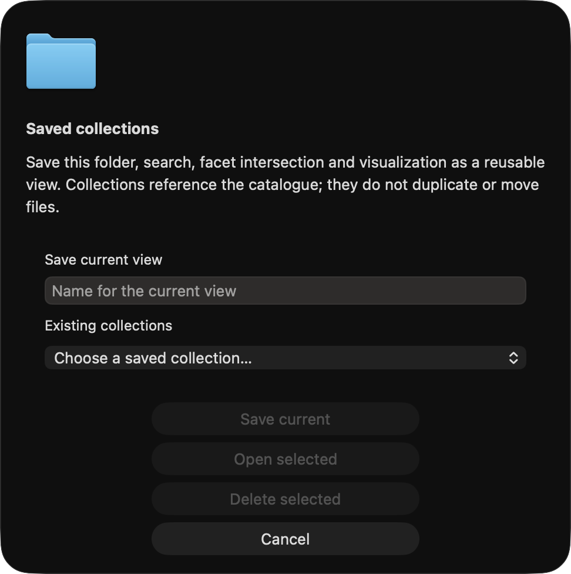{ loading=lazy decoding=async width="972" height="976" }
<figcaption>Real native AppKit view populated exclusively by the invented documentation library; no personal catalogue or file content. Capture performs no approved copy.</figcaption>
</figure>

Capture: `--documentation-capture` · Version: `0.5.2` · Origin: `generated-documentation-library-v1` · SHA-256: `97a107e53cc0c9fbc351c1a0d0c0553aa40d15b523ab1eba7b81110ddc26a5d1`

## Content Connections · dark

<figure markdown>
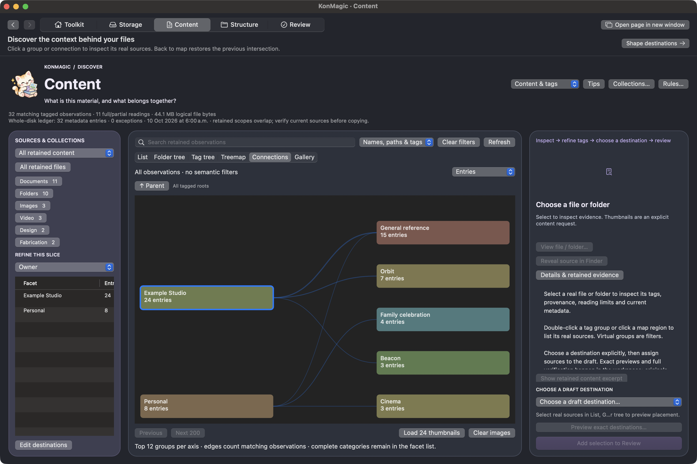{ loading=lazy decoding=async width="2960" height="1976" }
<figcaption>Real native AppKit view populated exclusively by the invented documentation library; no personal catalogue or file content. Capture performs no approved copy.</figcaption>
</figure>

Capture: `--documentation-capture` · Version: `0.5.2` · Origin: `generated-documentation-library-v1` · SHA-256: `ce0e224edcde9023fb9e5eb1b84e34d2be21bb7feb7a04354f50d0311950b56d`

## Content Filters · dark

<figure markdown>
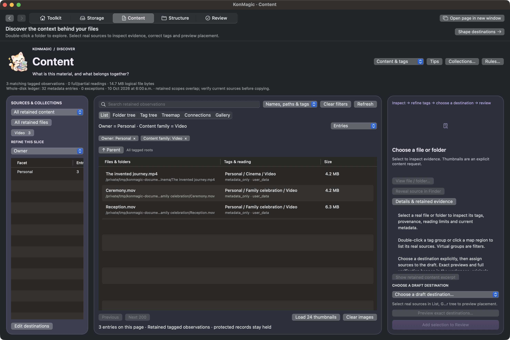{ loading=lazy decoding=async width="2960" height="1976" }
<figcaption>Real native AppKit view populated exclusively by the invented documentation library; no personal catalogue or file content. Capture performs no approved copy.</figcaption>
</figure>

Capture: `--documentation-capture` · Version: `0.5.2` · Origin: `generated-documentation-library-v1` · SHA-256: `aeee18d4d86e55b801e0cac81669d459c904718f516a6c45e307b91409f183dd`

## Content Folder Tree · dark

<figure markdown>
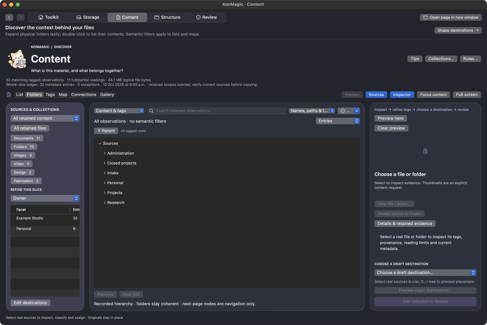{ loading=lazy decoding=async width="2960" height="1976" }
<figcaption>Real native AppKit view populated exclusively by the invented documentation library; no personal catalogue or file content. Capture performs no approved copy.</figcaption>
</figure>

Capture: `--documentation-capture` · Version: `0.5.2` · Origin: `generated-documentation-library-v1` · SHA-256: `ff77befdc109a49eff6691c1269431f8ea87935a62f51c61a63a42edc1df5cc7`

## Content Gallery Thumbnails · dark

<figure markdown>
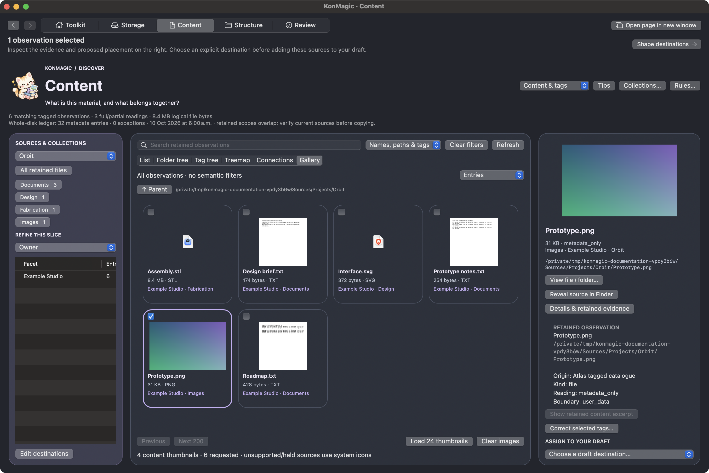{ loading=lazy decoding=async width="2960" height="1976" }
<figcaption>Real native AppKit view populated exclusively by the invented documentation library; no personal catalogue or file content. Capture performs no approved copy.</figcaption>
</figure>

Capture: `--documentation-capture` · Version: `0.5.2` · Origin: `generated-documentation-library-v1` · SHA-256: `ff7c529df4840c4709148ca0dff9bad519b47ce11345b2ea8b418d1cb923a661`

## Content Gallery · dark

<figure markdown>
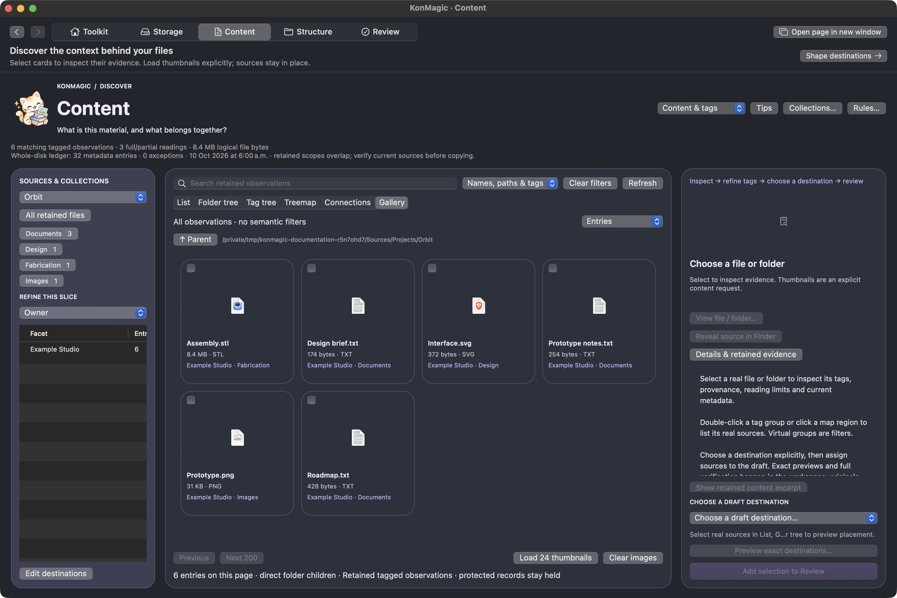{ loading=lazy decoding=async width="2960" height="1976" }
<figcaption>Real native AppKit view populated exclusively by the invented documentation library; no personal catalogue or file content. Capture performs no approved copy.</figcaption>
</figure>

Capture: `--documentation-capture` · Version: `0.5.2` · Origin: `generated-documentation-library-v1` · SHA-256: `9c579f074d1bbc2157b818c85f25bdac94d3223e993228761bd39f3c26b1fb77`

## Content Inspector · dark

<figure markdown>
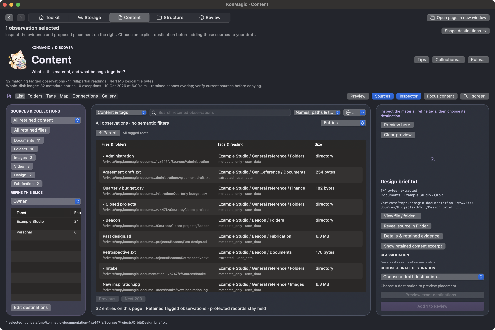{ loading=lazy decoding=async width="2960" height="1976" }
<figcaption>Real native AppKit view populated exclusively by the invented documentation library; no personal catalogue or file content. Capture performs no approved copy.</figcaption>
</figure>

Capture: `--documentation-capture` · Version: `0.5.2` · Origin: `generated-documentation-library-v1` · SHA-256: `823daad0bfe8b264e897e0137133aff4cdcffa48d70c812394116d9d1a3e2d2f`

## Content List · dark

<figure markdown>
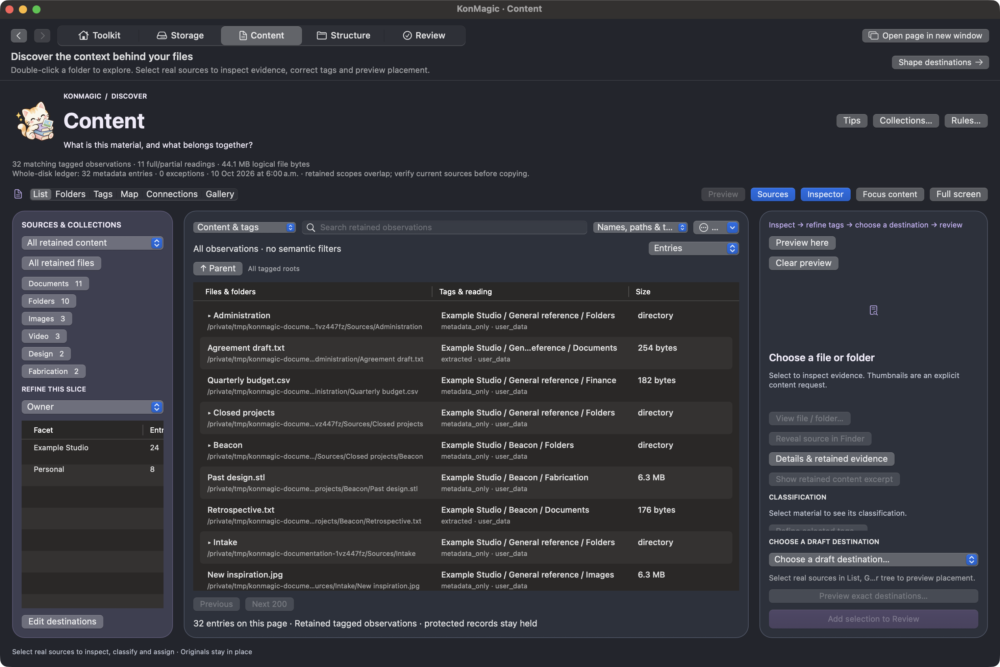{ loading=lazy decoding=async width="2960" height="1976" }
<figcaption>Real native AppKit view populated exclusively by the invented documentation library; no personal catalogue or file content. Capture performs no approved copy.</figcaption>
</figure>

Capture: `--documentation-capture` · Version: `0.5.2` · Origin: `generated-documentation-library-v1` · SHA-256: `a8f5d433e3929b4b0ba3bb5d64672f4d250c8ce6566451304d7980e4cd6050fa`

## Content Reading · dark

<figure markdown>
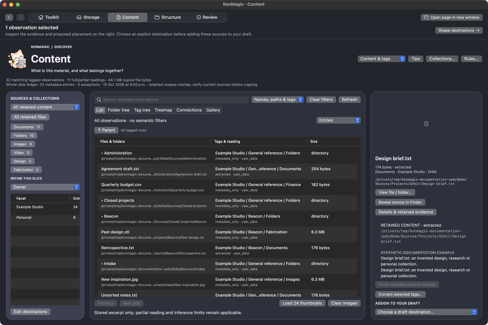{ loading=lazy decoding=async width="2960" height="1976" }
<figcaption>Real native AppKit view populated exclusively by the invented documentation library; no personal catalogue or file content. Capture performs no approved copy.</figcaption>
</figure>

Capture: `--documentation-capture` · Version: `0.5.2` · Origin: `generated-documentation-library-v1` · SHA-256: `4ff48b7d84ca9a315cc16d6d3d62fc00f441a46fd1296bc29228784a1e23642f`

## Content Restored · dark

<figure markdown>
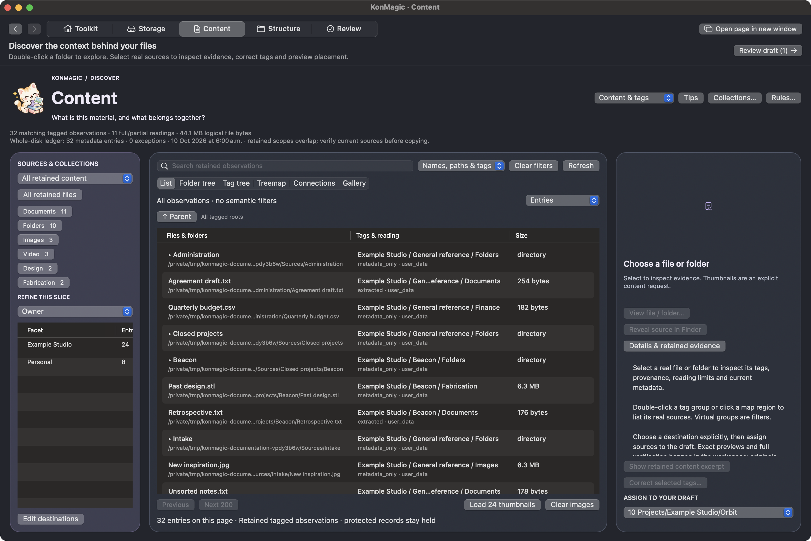{ loading=lazy decoding=async width="2960" height="1976" }
<figcaption>Real native AppKit view populated exclusively by the invented documentation library; no personal catalogue or file content. Capture performs no approved copy.</figcaption>
</figure>

Capture: `--documentation-capture` · Version: `0.5.2` · Origin: `generated-documentation-library-v1` · SHA-256: `e39fba3db53b5fe8ff45d8973d9080612018df881cd124c71457fdbf5ddbe74a`

## Content Tag Tree · dark

<figure markdown>
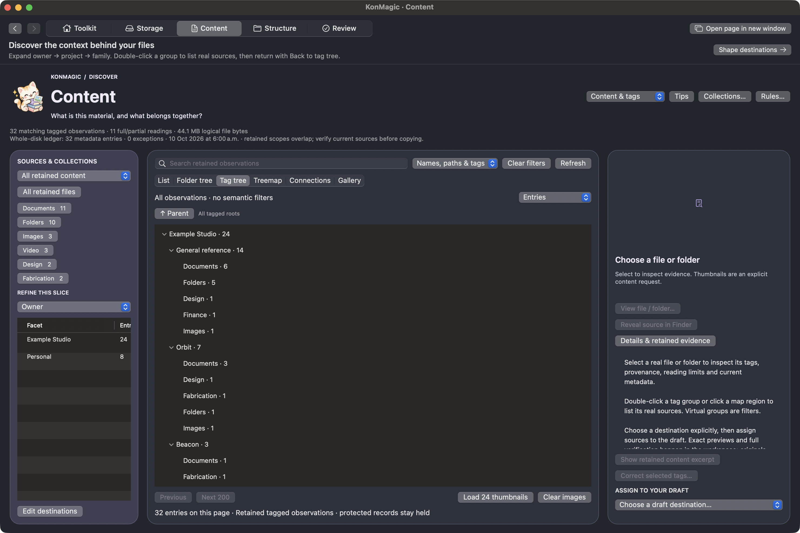{ loading=lazy decoding=async width="2960" height="1976" }
<figcaption>Real native AppKit view populated exclusively by the invented documentation library; no personal catalogue or file content. Capture performs no approved copy.</figcaption>
</figure>

Capture: `--documentation-capture` · Version: `0.5.2` · Origin: `generated-documentation-library-v1` · SHA-256: `e22690a556ffd4aee61e9b8418c702ab4526c985c9c0a1fc9637e4c0c6962722`

## Content Treemap · dark

<figure markdown>
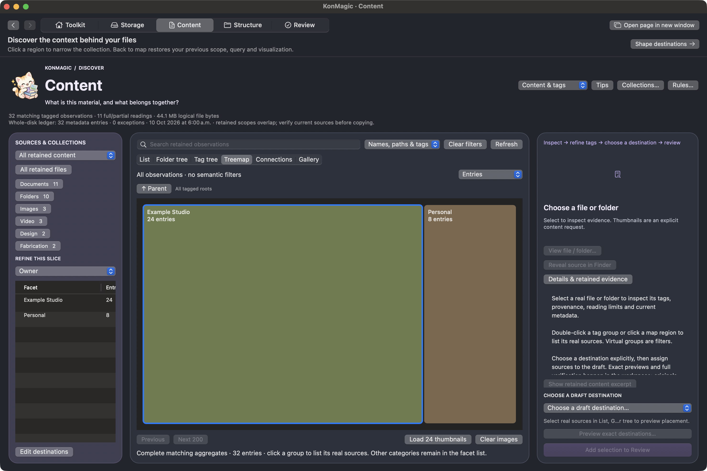{ loading=lazy decoding=async width="2960" height="1976" }
<figcaption>Real native AppKit view populated exclusively by the invented documentation library; no personal catalogue or file content. Capture performs no approved copy.</figcaption>
</figure>

Capture: `--documentation-capture` · Version: `0.5.2` · Origin: `generated-documentation-library-v1` · SHA-256: `285c475b3a52e5a61c6e8474b1e08195a1ad505ba948b673983652f434bb44f1`

## Copy Confirmation · dark

<figure markdown>
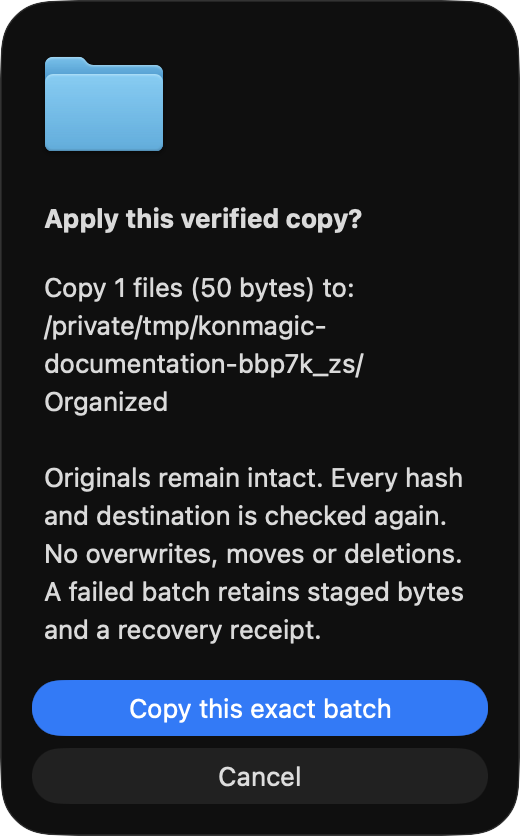{ loading=lazy decoding=async width="520" height="836" }
<figcaption>Real native AppKit view populated exclusively by the invented documentation library; no personal catalogue or file content. Capture performs no approved copy.</figcaption>
</figure>

Capture: `--documentation-capture` · Version: `0.5.2` · Origin: `generated-documentation-library-v1` · SHA-256: `a7e53ef375acd59b3746a0b852be8124773c398e32854621f9f32211fc5568e2`

## Create Rule · dark

<figure markdown>
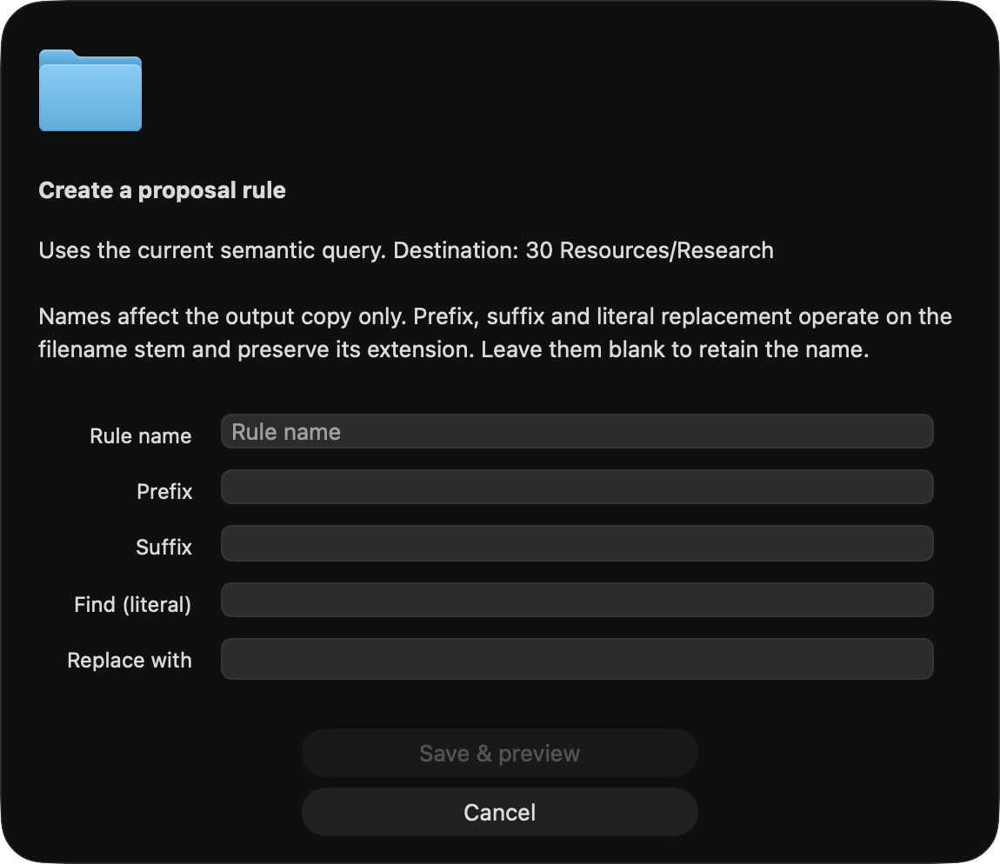{ loading=lazy decoding=async width="1150" height="994" }
<figcaption>Real native AppKit view populated exclusively by the invented documentation library; no personal catalogue or file content. Capture performs no approved copy.</figcaption>
</figure>

Capture: `--documentation-capture` · Version: `0.5.2` · Origin: `generated-documentation-library-v1` · SHA-256: `533d4e658f3213f1b7218c63595ee6a7ecffed65dc282fc2db85467426bf937c`

## File Viewer · dark

<figure markdown>
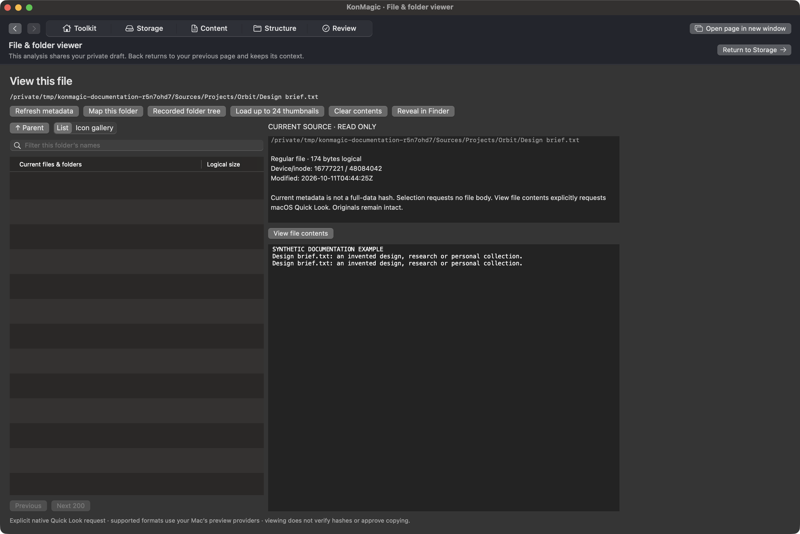{ loading=lazy decoding=async width="2960" height="1976" }
<figcaption>Real native AppKit view populated exclusively by the invented documentation library; no personal catalogue or file content. Capture performs no approved copy.</figcaption>
</figure>

Capture: `--documentation-capture` · Version: `0.5.2` · Origin: `generated-documentation-library-v1` · SHA-256: `8d1d4b74d76b2c9356d54b55cc1d5ef801acc4ff8d47707517999d1896bb9abb`

## Folder Gallery · dark

<figure markdown>
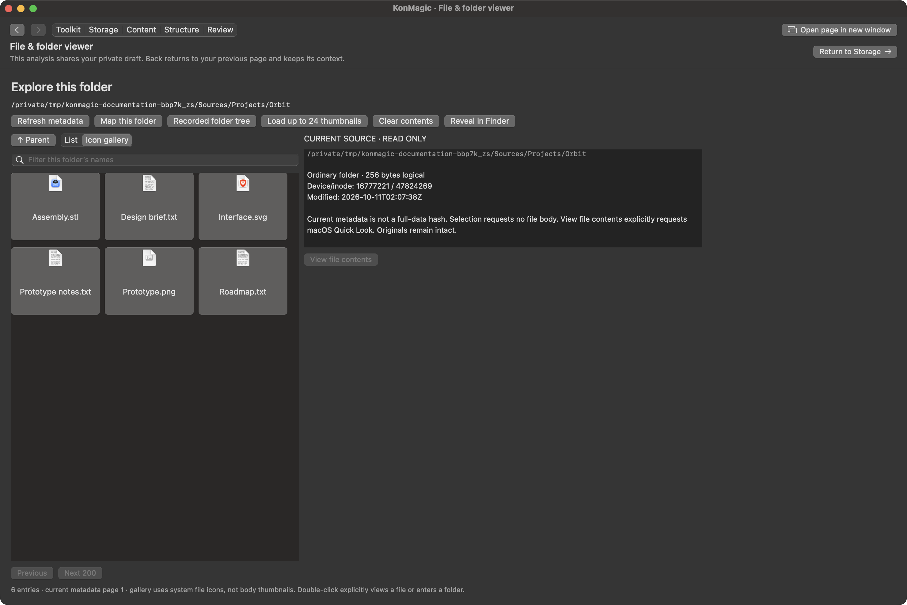{ loading=lazy decoding=async width="2960" height="1976" }
<figcaption>Real native AppKit view populated exclusively by the invented documentation library; no personal catalogue or file content. Capture performs no approved copy.</figcaption>
</figure>

Capture: `--documentation-capture` · Version: `0.5.2` · Origin: `generated-documentation-library-v1` · SHA-256: `dabad032fb8e4e1dc6f2e06473817cdade6c78f3f7f540adffa917baadc5e07f`

## Folder Thumbnails · dark

<figure markdown>
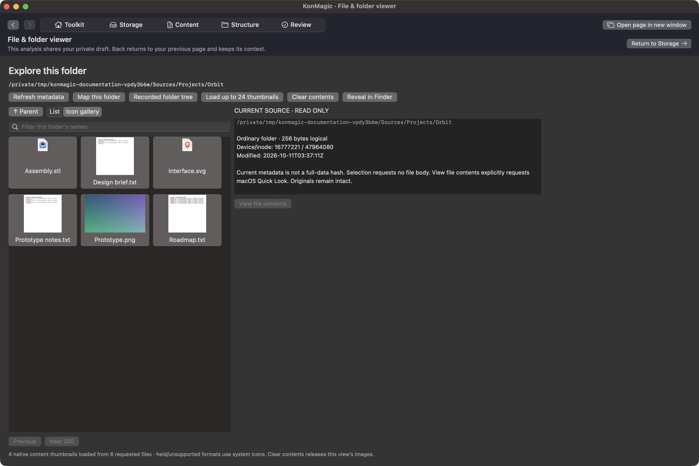{ loading=lazy decoding=async width="2960" height="1976" }
<figcaption>Real native AppKit view populated exclusively by the invented documentation library; no personal catalogue or file content. Capture performs no approved copy.</figcaption>
</figure>

Capture: `--documentation-capture` · Version: `0.5.2` · Origin: `generated-documentation-library-v1` · SHA-256: `ba5a7245b57c66b7119c84c4c5d3a4ffd5f14293ba69f6c39378e7dfea24768a`

## Folder Viewer · dark

<figure markdown>
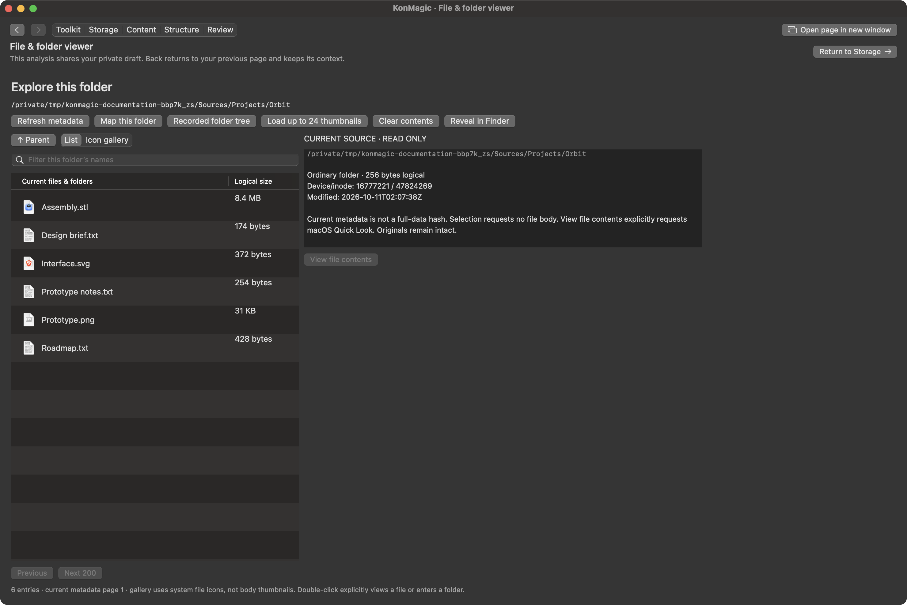{ loading=lazy decoding=async width="2960" height="1976" }
<figcaption>Real native AppKit view populated exclusively by the invented documentation library; no personal catalogue or file content. Capture performs no approved copy.</figcaption>
</figure>

Capture: `--documentation-capture` · Version: `0.5.2` · Origin: `generated-documentation-library-v1` · SHA-256: `b60639118086a00b42f27563eb20ed7753b6398df85a8a800385e3eeb5ab959a`

## Image Viewer · dark

<figure markdown>
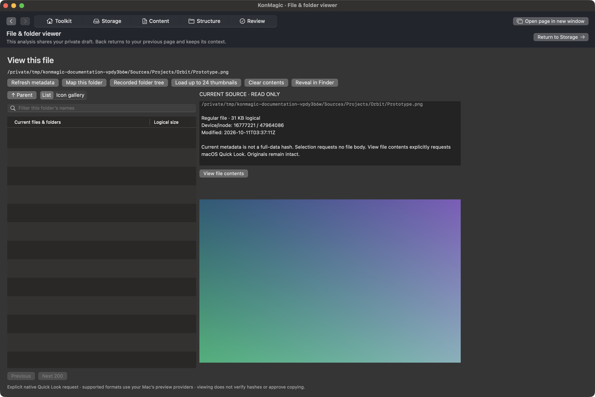{ loading=lazy decoding=async width="2960" height="1976" }
<figcaption>Real native AppKit view populated exclusively by the invented documentation library; no personal catalogue or file content. Capture performs no approved copy.</figcaption>
</figure>

Capture: `--documentation-capture` · Version: `0.5.2` · Origin: `generated-documentation-library-v1` · SHA-256: `0783283c183c5fd4ed27d59ebb7ac48a9ec8a58152ef0e9567668f4e4f6f708e`

## Mask Editor · dark

<figure markdown>
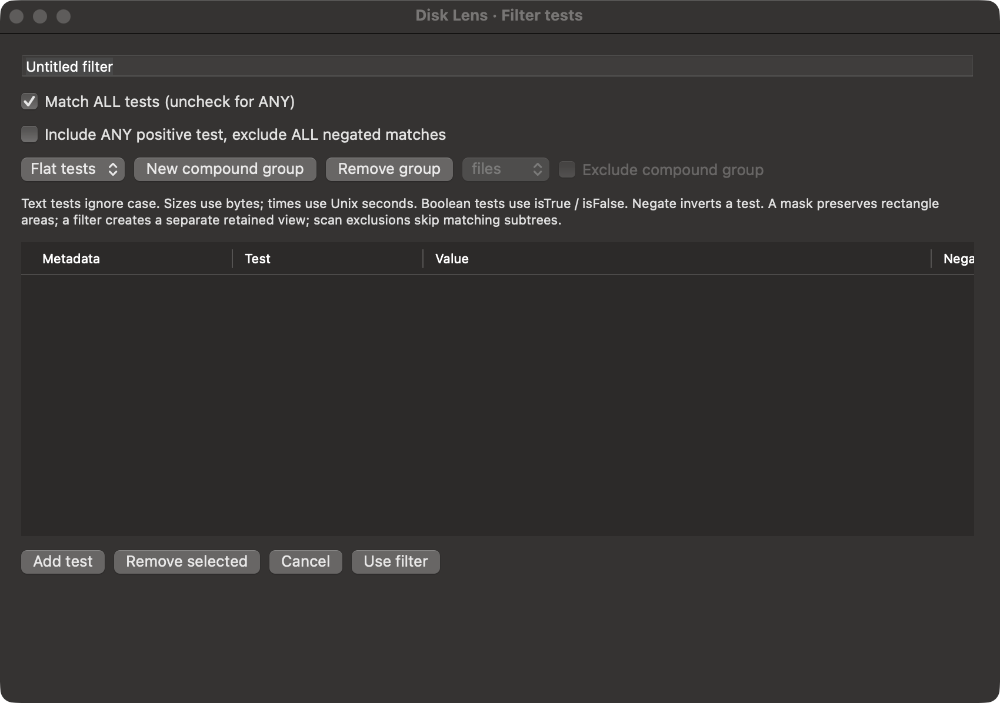{ loading=lazy decoding=async width="1700" height="1196" }
<figcaption>Real native AppKit view populated exclusively by the invented documentation library; no personal catalogue or file content. Capture performs no approved copy.</figcaption>
</figure>

Capture: `--documentation-capture` · Version: `0.5.2` · Origin: `generated-documentation-library-v1` · SHA-256: `f94701c8b2715c306fd8de7d7c80d3c26ceb3838d791a94c8680c6887dffa273`

## New Folder · dark

<figure markdown>
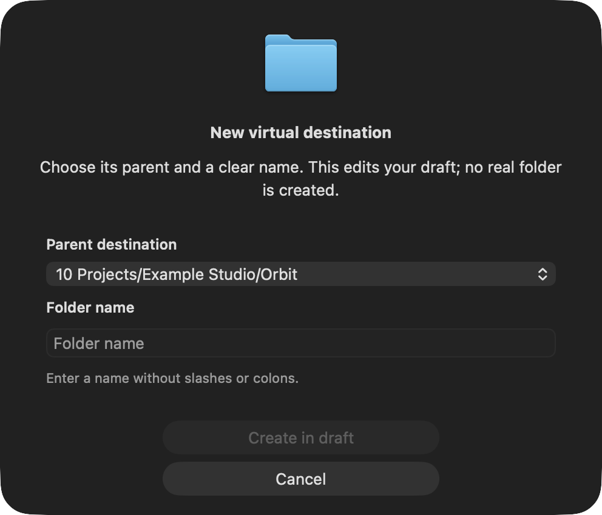{ loading=lazy decoding=async width="992" height="850" }
<figcaption>Real native AppKit view populated exclusively by the invented documentation library; no personal catalogue or file content. Capture performs no approved copy.</figcaption>
</figure>

Capture: `--documentation-capture` · Version: `0.5.2` · Origin: `generated-documentation-library-v1` · SHA-256: `4955ebd6b53707f460ba02578b8b708c24bb58e2cbbe72c126e8d0249f4e1338`

## Placement Preview · dark

<figure markdown>
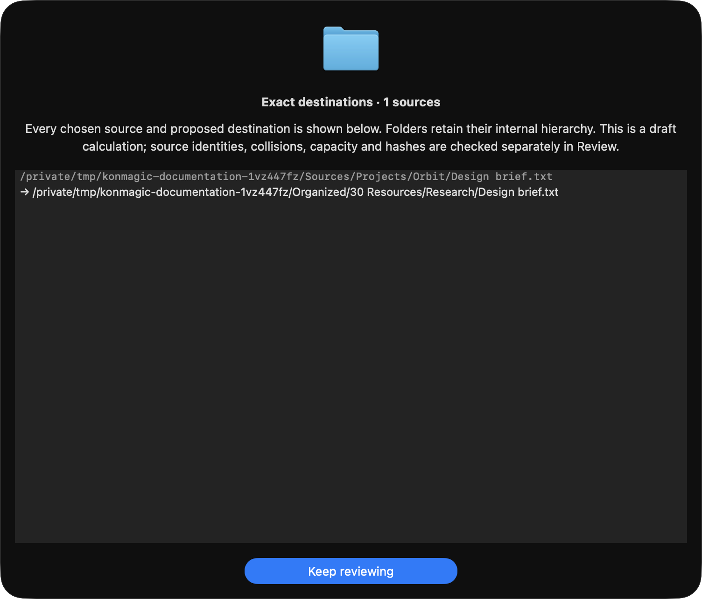{ loading=lazy decoding=async width="1504" height="1284" }
<figcaption>Real native AppKit view populated exclusively by the invented documentation library; no personal catalogue or file content. Capture performs no approved copy.</figcaption>
</figure>

Capture: `--documentation-capture` · Version: `0.5.2` · Origin: `generated-documentation-library-v1` · SHA-256: `d8df5642b5f0e07fbff06aba387f59b3d6a368bd8a88cf7dd9114591d50c8e76`

## Preferences · dark

<figure markdown>
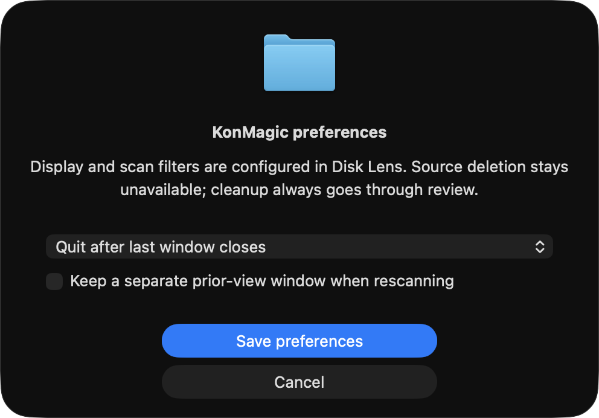{ loading=lazy decoding=async width="992" height="692" }
<figcaption>Real native AppKit view populated exclusively by the invented documentation library; no personal catalogue or file content. Capture performs no approved copy.</figcaption>
</figure>

Capture: `--documentation-capture` · Version: `0.5.2` · Origin: `generated-documentation-library-v1` · SHA-256: `eb8f064ea4d116cd73f652c2cb64e6c765252dedb0a2f666c2556f47797cf7ec`

## Recorded Disk · dark

<figure markdown>
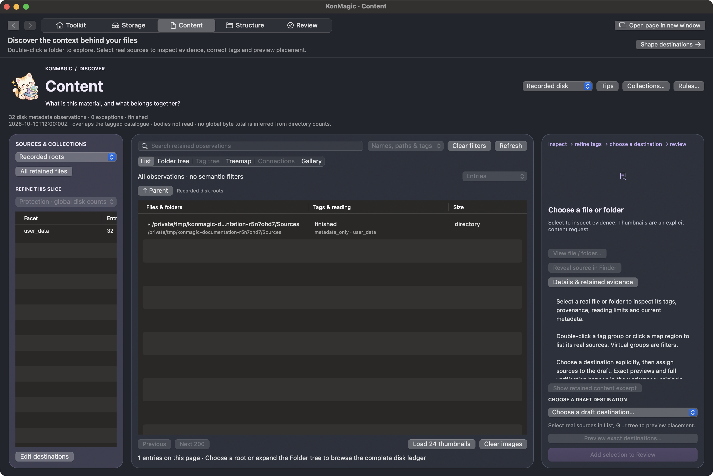{ loading=lazy decoding=async width="2960" height="1976" }
<figcaption>Real native AppKit view populated exclusively by the invented documentation library; no personal catalogue or file content. Capture performs no approved copy.</figcaption>
</figure>

Capture: `--documentation-capture` · Version: `0.5.2` · Origin: `generated-documentation-library-v1` · SHA-256: `4e0152b109028636c3cc0871d7bf967acc2b622df02963763c6468ef6acf30fe`

## Review Unverified · dark

<figure markdown>
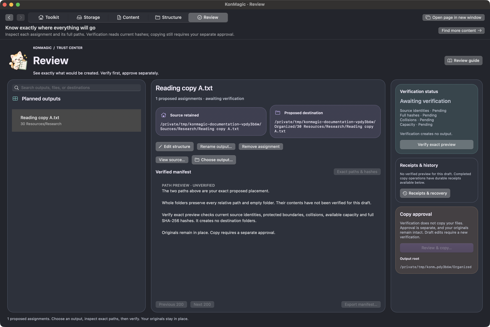{ loading=lazy decoding=async width="2960" height="1976" }
<figcaption>Real native AppKit view populated exclusively by the invented documentation library; no personal catalogue or file content. Capture performs no approved copy.</figcaption>
</figure>

Capture: `--documentation-capture` · Version: `0.5.2` · Origin: `generated-documentation-library-v1` · SHA-256: `c7f423ddf24a3ba85d1460d3f0b12bf9cd64c253ce06656596e8f385235e2140`

## Review Verified · dark

<figure markdown>
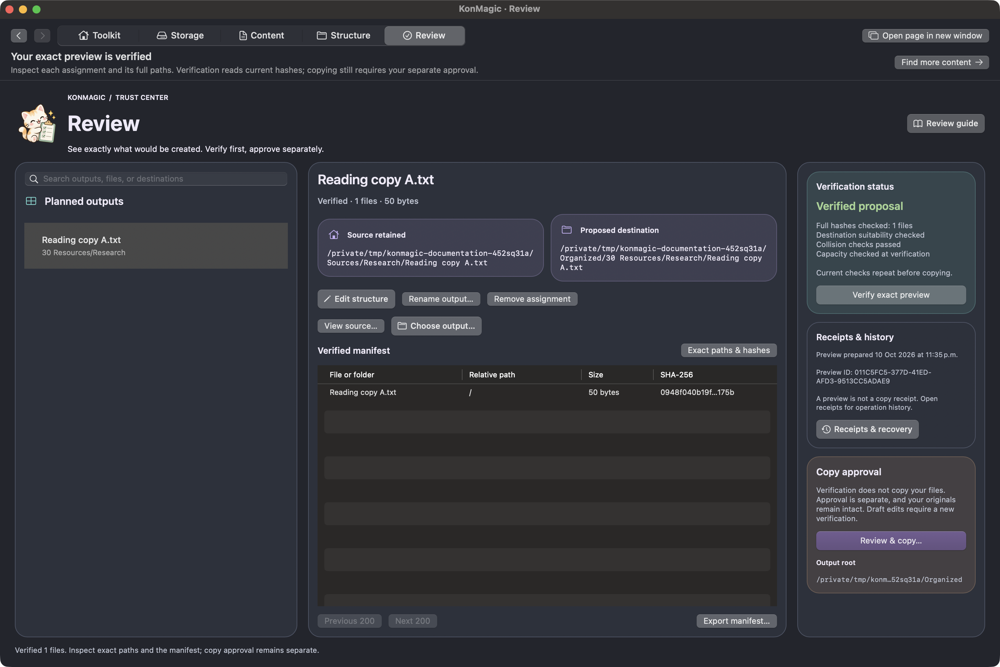{ loading=lazy decoding=async width="2960" height="1976" }
<figcaption>Exact preview verified against one small generated temporary file using the test-only fixture allowance. No copy is approved.</figcaption>
</figure>

Capture: `--documentation-capture` · Version: `0.5.2` · Origin: `generated-documentation-library-v1` · SHA-256: `12879b2c0eb901134be446d0011e6c18b5aa77e3d5a51ecb5b9d36388d5694e2`

## Rules · dark

<figure markdown>
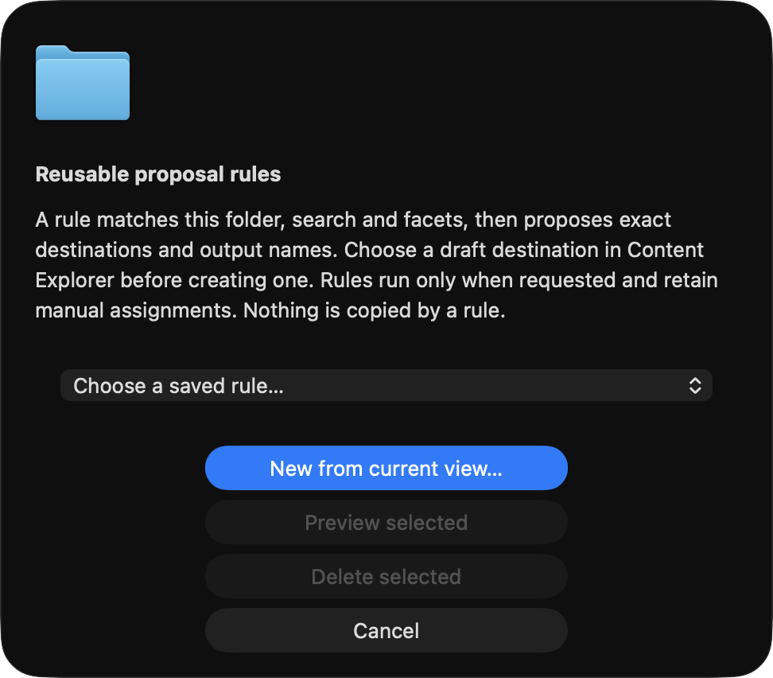{ loading=lazy decoding=async width="972" height="852" }
<figcaption>Real native AppKit view populated exclusively by the invented documentation library; no personal catalogue or file content. Capture performs no approved copy.</figcaption>
</figure>

Capture: `--documentation-capture` · Version: `0.5.2` · Origin: `generated-documentation-library-v1` · SHA-256: `6e49fa2a86a00198e543ea6f452388036e035b345e083701601b05a9a11a1c2f`

## Scan Filters · dark

<figure markdown>
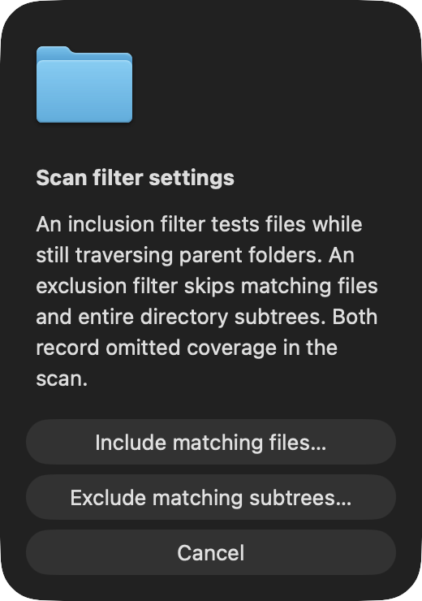{ loading=lazy decoding=async width="520" height="740" }
<figcaption>Real native AppKit view populated exclusively by the invented documentation library; no personal catalogue or file content. Capture performs no approved copy.</figcaption>
</figure>

Capture: `--documentation-capture` · Version: `0.5.2` · Origin: `generated-documentation-library-v1` · SHA-256: `c28e91315402d2aaaf5780d9e47c47ceec12c5333988d8f4d90c667286f70a4d`

## Scan Notes · dark

<figure markdown>
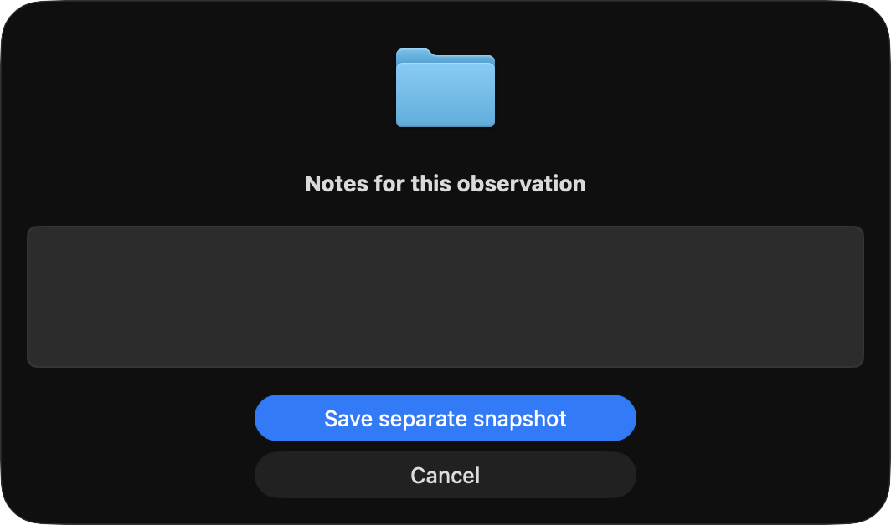{ loading=lazy decoding=async width="1064" height="628" }
<figcaption>Real native AppKit view populated exclusively by the invented documentation library; no personal catalogue or file content. Capture performs no approved copy.</figcaption>
</figure>

Capture: `--documentation-capture` · Version: `0.5.2` · Origin: `generated-documentation-library-v1` · SHA-256: `028f7879f485d506b767032d028b9bfc00183baca79282e9a3b27a70a476129d`

## Storage Focused · dark

<figure markdown>
{ loading=lazy decoding=async width="2960" height="1976" }
<figcaption>Real native AppKit view populated exclusively by the invented documentation library; no personal catalogue or file content. Capture performs no approved copy.</figcaption>
</figure>

Capture: `--documentation-capture` · Version: `0.5.2` · Origin: `generated-documentation-library-v1` · SHA-256: `cf5a8ef2857d724f173713268054e9de9d9ddd23ce28e8448856fe914f3d02d0`

## Storage Map Focus · dark

<figure markdown>
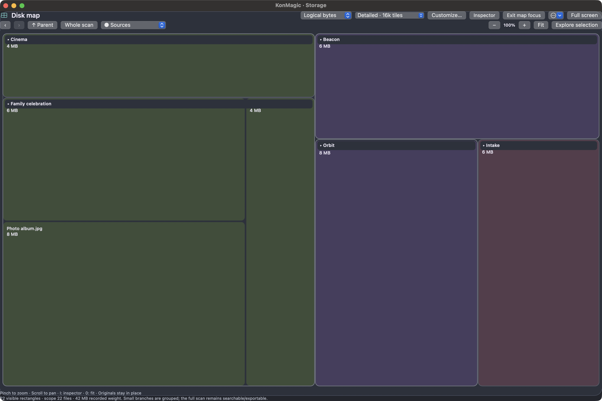{ loading=lazy decoding=async width="2960" height="1976" }
<figcaption>Real native AppKit view populated exclusively by the invented documentation library; no personal catalogue or file content. Capture performs no approved copy.</figcaption>
</figure>

Capture: `--documentation-capture` · Version: `0.5.2` · Origin: `generated-documentation-library-v1` · SHA-256: `a56108956359d17713bbcca498ebbdd58d27bbb87c02a1468667f6f2b23c7350`

## Storage Map Inspector · dark

<figure markdown>
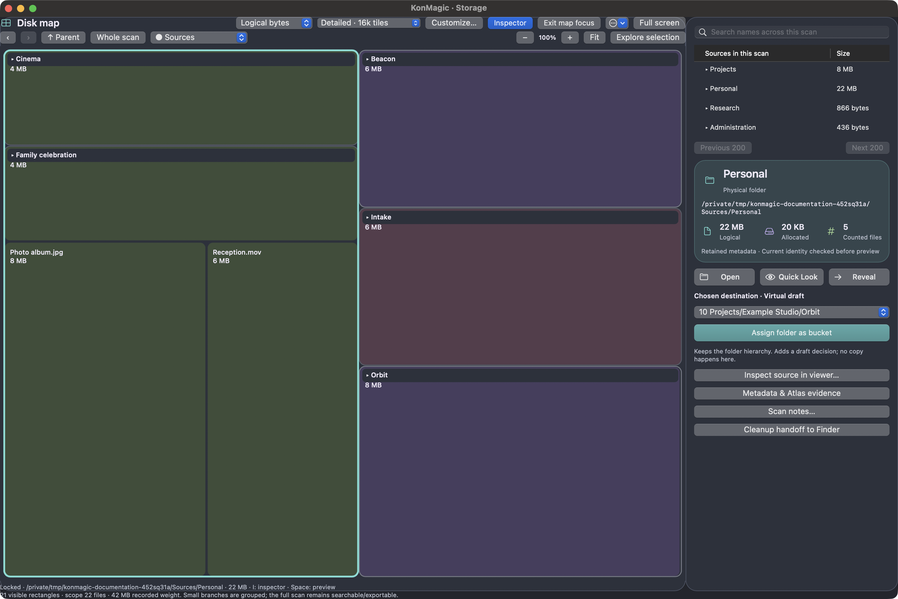{ loading=lazy decoding=async width="2960" height="1976" }
<figcaption>Real native AppKit view populated exclusively by the invented documentation library; no personal catalogue or file content. Capture performs no approved copy.</figcaption>
</figure>

Capture: `--documentation-capture` · Version: `0.5.2` · Origin: `generated-documentation-library-v1` · SHA-256: `4859a010d9324f0a8d47d14b99a63a46f527daad242d06bd48ffe5f28fa7aa84`

## Storage Map Restored · dark

<figure markdown>
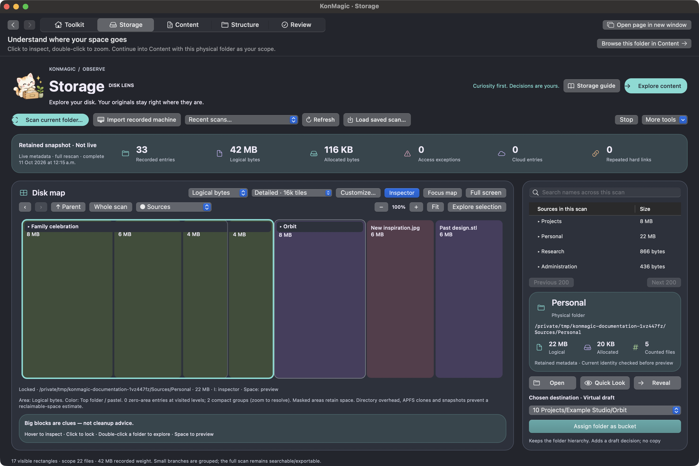{ loading=lazy decoding=async width="2960" height="1976" }
<figcaption>Real native AppKit view populated exclusively by the invented documentation library; no personal catalogue or file content. Capture performs no approved copy.</figcaption>
</figure>

Capture: `--documentation-capture` · Version: `0.5.2` · Origin: `generated-documentation-library-v1` · SHA-256: `1c6b543db30fd9e38f08349cf294aa7ee766c4a6cb249959170ff5276d15748f`

## Storage Map Zoom · dark

<figure markdown>
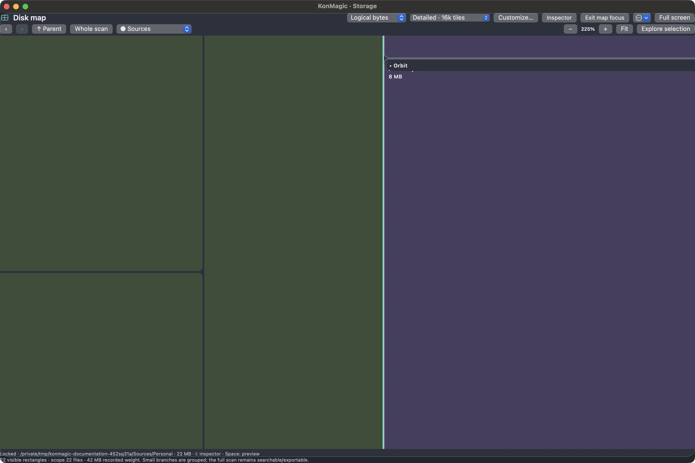{ loading=lazy decoding=async width="2960" height="1976" }
<figcaption>Real native AppKit view populated exclusively by the invented documentation library; no personal catalogue or file content. Capture performs no approved copy.</figcaption>
</figure>

Capture: `--documentation-capture` · Version: `0.5.2` · Origin: `generated-documentation-library-v1` · SHA-256: `ac5c82dca087565b853829c3c5bf74578b90afa0d961bfe80eb9b7049d99dcda`

## Storage Options · dark

<figure markdown>
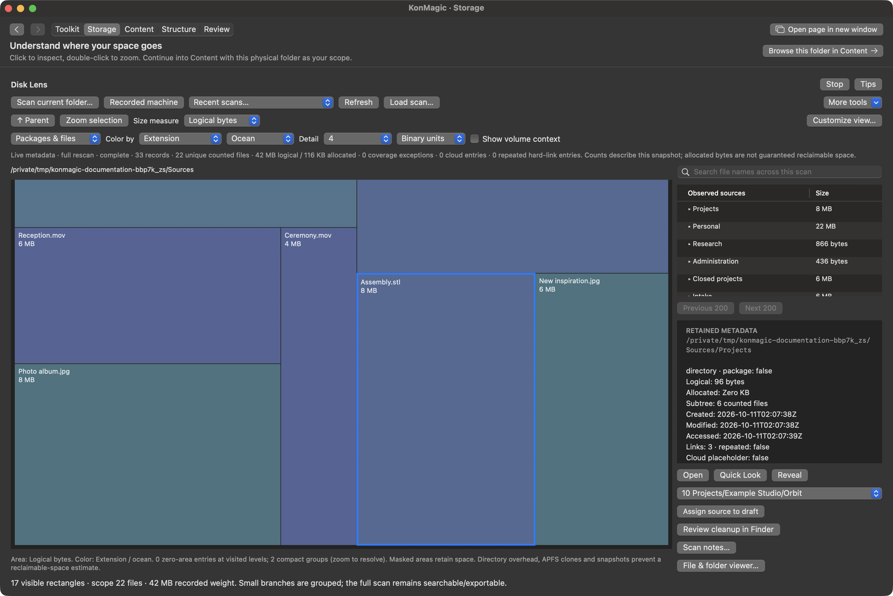{ loading=lazy decoding=async width="2960" height="1976" }
<figcaption>Real native AppKit view populated exclusively by the invented documentation library; no personal catalogue or file content. Capture performs no approved copy.</figcaption>
</figure>

Capture: `--documentation-capture` · Version: `0.5.2` · Origin: `generated-documentation-library-v1` · SHA-256: `9477b6c1576d114dcca0a09b2c909dc96f4d6edf246b60b7852fff08af328b1e`

## Storage · dark

<figure markdown>
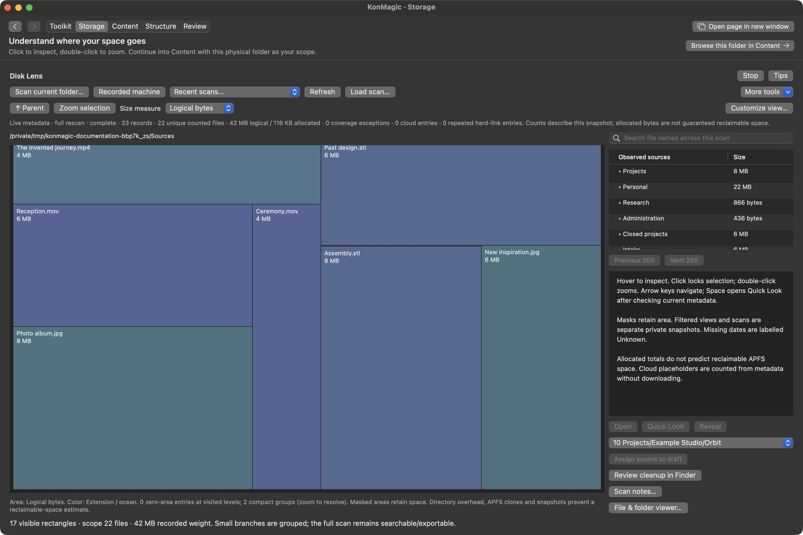{ loading=lazy decoding=async width="2960" height="1976" }
<figcaption>Real native AppKit view populated exclusively by the invented documentation library; no personal catalogue or file content. Capture performs no approved copy.</figcaption>
</figure>

Capture: `--documentation-capture` · Version: `0.5.2` · Origin: `generated-documentation-library-v1` · SHA-256: `0b61c5a173dd5855f5f6644f50c02884a215d959eecdd3622ae478d2fad763cb`

## Structure · dark

<figure markdown>
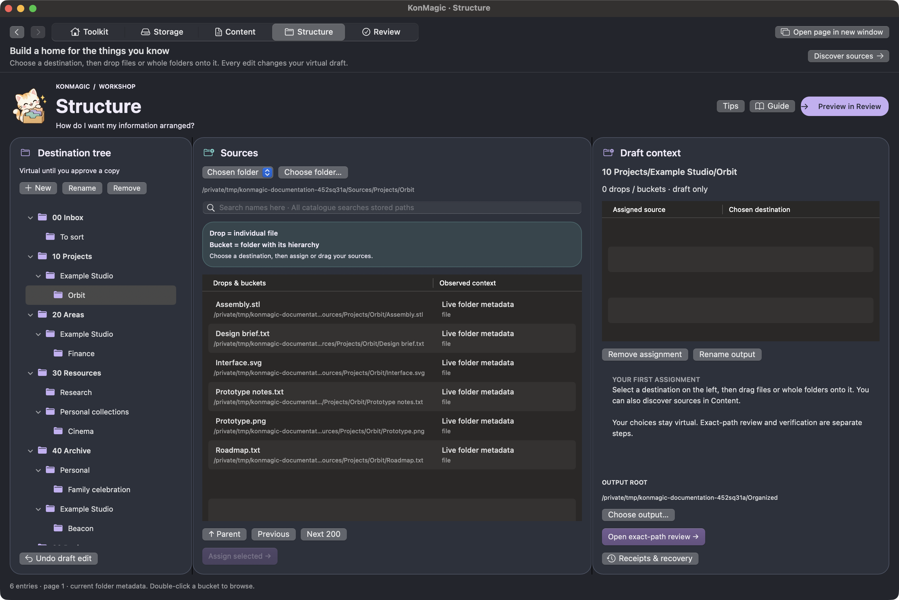{ loading=lazy decoding=async width="2960" height="1976" }
<figcaption>Real native AppKit view populated exclusively by the invented documentation library; no personal catalogue or file content. Capture performs no approved copy.</figcaption>
</figure>

Capture: `--documentation-capture` · Version: `0.5.2` · Origin: `generated-documentation-library-v1` · SHA-256: `9acee255f510832e6a8eb5fe3318c3a58f1dffa7a1e923fa2132a11bd0b2fc94`

## Tag Corrections · dark

<figure markdown>
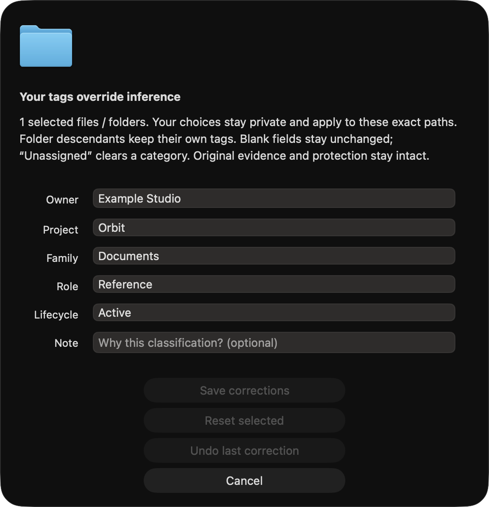{ loading=lazy decoding=async width="1170" height="1184" }
<figcaption>Real native AppKit view populated exclusively by the invented documentation library; no personal catalogue or file content. Capture performs no approved copy.</figcaption>
</figure>

Capture: `--documentation-capture` · Version: `0.5.2` · Origin: `generated-documentation-library-v1` · SHA-256: `9522d795ac25905ee2362a9566e0f926b508e038607e37b09c0176f40ccea725`

## Toolkit · dark

<figure markdown>
{ loading=lazy decoding=async width="2960" height="1976" }
<figcaption>Real native AppKit view populated exclusively by the invented documentation library; no personal catalogue or file content. Capture performs no approved copy.</figcaption>
</figure>

Capture: `--documentation-capture` · Version: `0.5.2` · Origin: `generated-documentation-library-v1` · SHA-256: `269335bf570d26d074f57fa54ab7495243aa23523fcca940ef2ec4ed9010fd9e`

## Welcome 1 · dark

<figure markdown>
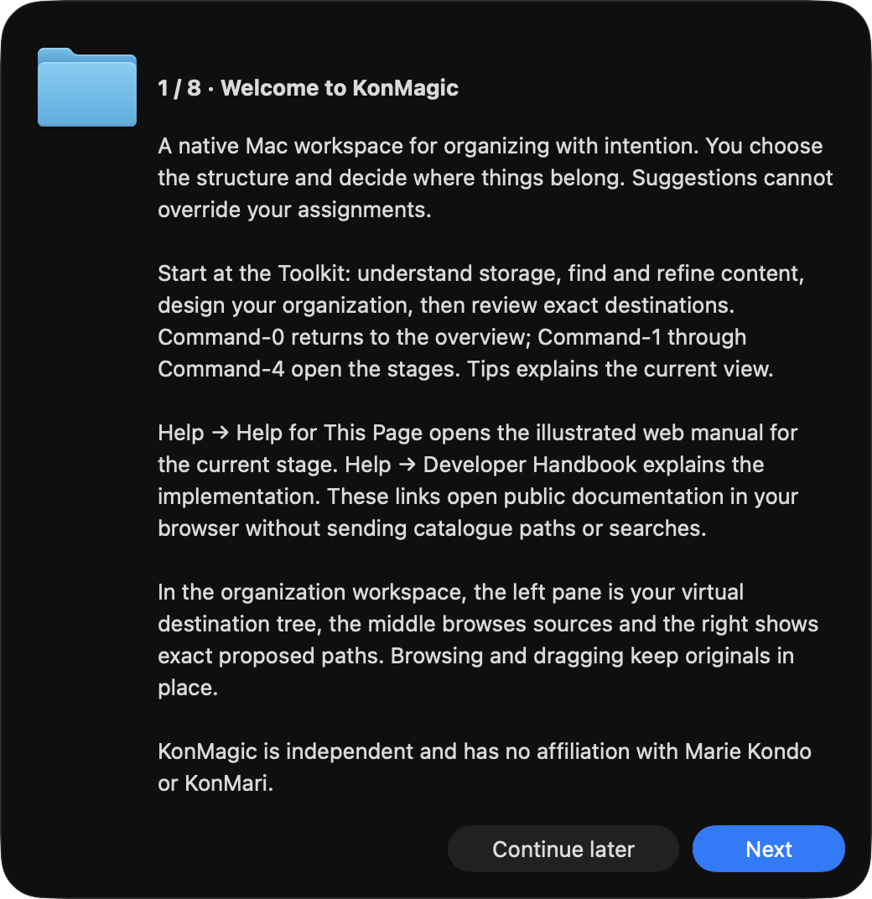{ loading=lazy decoding=async width="1040" height="1072" }
<figcaption>Real native AppKit view populated exclusively by the invented documentation library; no personal catalogue or file content. Capture performs no approved copy.</figcaption>
</figure>

Capture: `--documentation-capture` · Version: `0.5.2` · Origin: `generated-documentation-library-v1` · SHA-256: `dd3dfc084fe2d45d5a2810d925c9c4adabc477c204ecc70081ace7abd480de56`

## Welcome 2 · dark

<figure markdown>
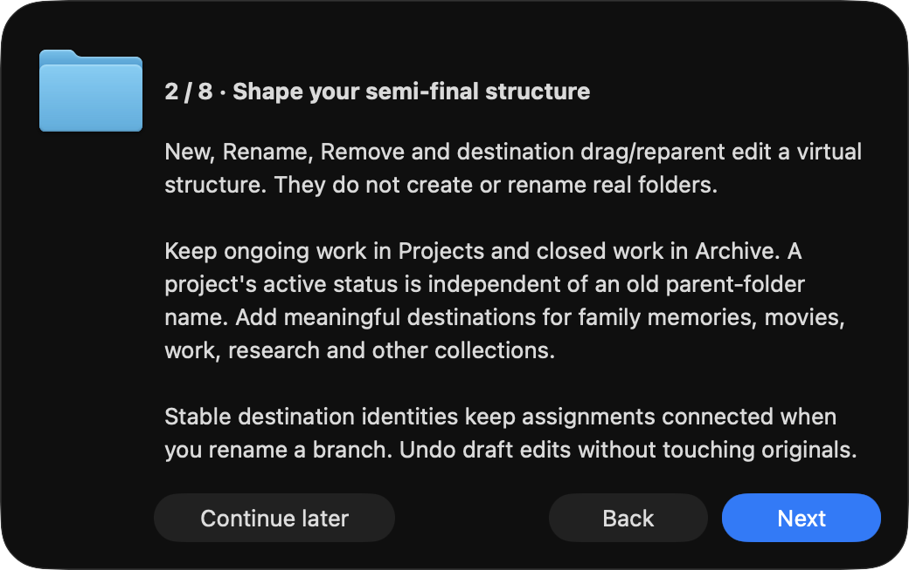{ loading=lazy decoding=async width="1040" height="654" }
<figcaption>Real native AppKit view populated exclusively by the invented documentation library; no personal catalogue or file content. Capture performs no approved copy.</figcaption>
</figure>

Capture: `--documentation-capture` · Version: `0.5.2` · Origin: `generated-documentation-library-v1` · SHA-256: `6842de5b5d8439757571762c82f83960f92a303241adde368709467ddfcd6dff`

## Welcome 3 · dark

<figure markdown>
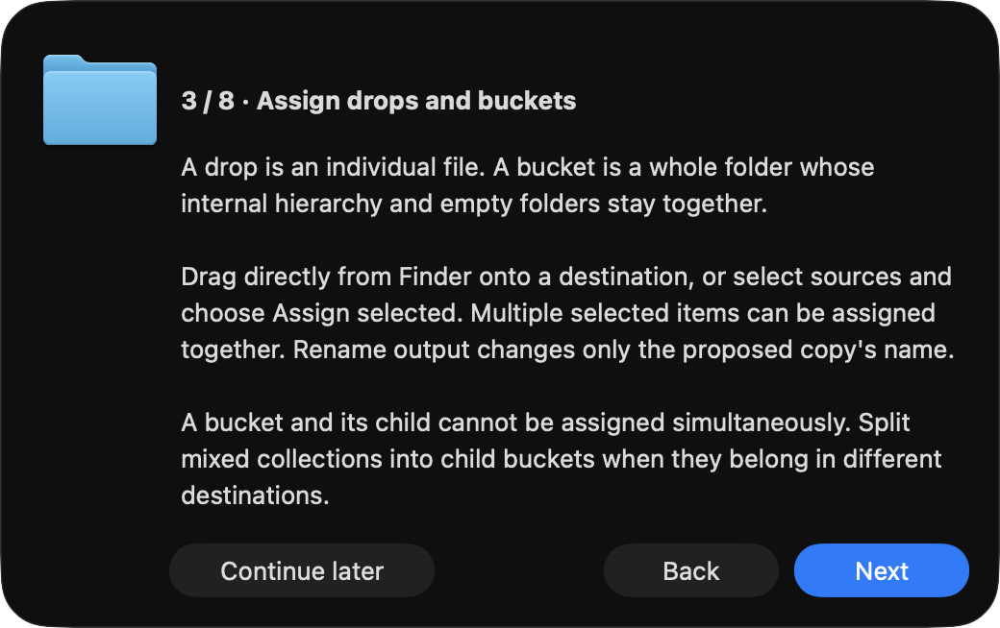{ loading=lazy decoding=async width="1040" height="654" }
<figcaption>Real native AppKit view populated exclusively by the invented documentation library; no personal catalogue or file content. Capture performs no approved copy.</figcaption>
</figure>

Capture: `--documentation-capture` · Version: `0.5.2` · Origin: `generated-documentation-library-v1` · SHA-256: `883a10971016deea7d439603ceb19e153c08495903b9f9e4fe6b3c5e2cc796c9`

## Welcome 4 · dark

<figure markdown>
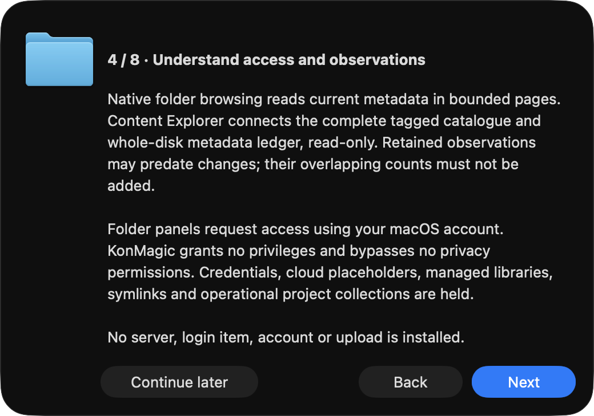{ loading=lazy decoding=async width="1040" height="730" }
<figcaption>Real native AppKit view populated exclusively by the invented documentation library; no personal catalogue or file content. Capture performs no approved copy.</figcaption>
</figure>

Capture: `--documentation-capture` · Version: `0.5.2` · Origin: `generated-documentation-library-v1` · SHA-256: `bfbca6aef185894153e35befeca7598d5dec94cd6d517348e9964f013dc1ae61`

## Welcome 5 · dark

<figure markdown>
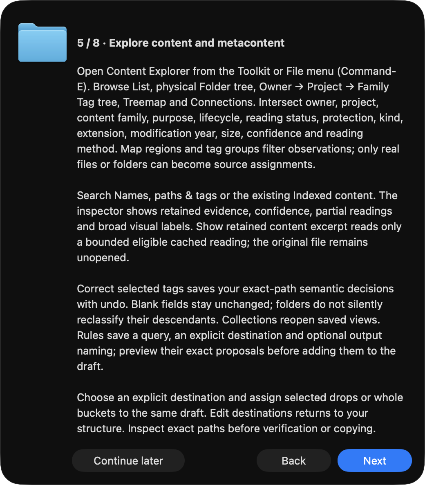{ loading=lazy decoding=async width="1040" height="1186" }
<figcaption>Real native AppKit view populated exclusively by the invented documentation library; no personal catalogue or file content. Capture performs no approved copy.</figcaption>
</figure>

Capture: `--documentation-capture` · Version: `0.5.2` · Origin: `generated-documentation-library-v1` · SHA-256: `4d31d165bce59c6ea4654f99500a80b36ee44f875cbb4f082d5be626f523bd77`

## Welcome 6 · dark

<figure markdown>
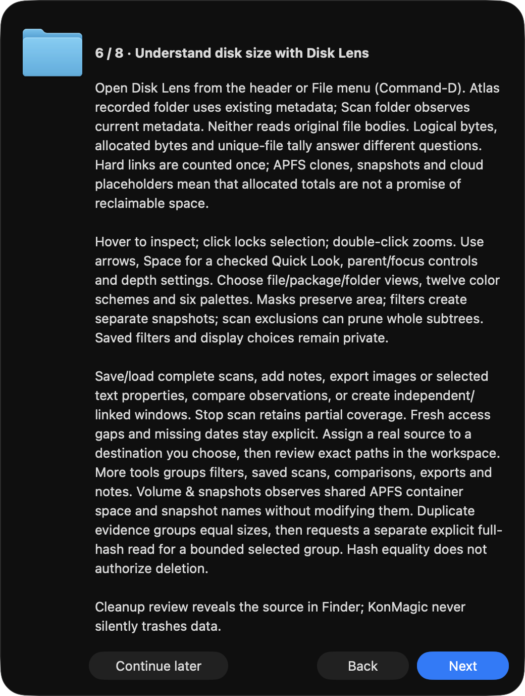{ loading=lazy decoding=async width="1040" height="1376" }
<figcaption>Real native AppKit view populated exclusively by the invented documentation library; no personal catalogue or file content. Capture performs no approved copy.</figcaption>
</figure>

Capture: `--documentation-capture` · Version: `0.5.2` · Origin: `generated-documentation-library-v1` · SHA-256: `dee676954c9209102670888f2656cc7ed743920b180eb378ec5fa6d72271655d`

## Welcome 7 · dark

<figure markdown>
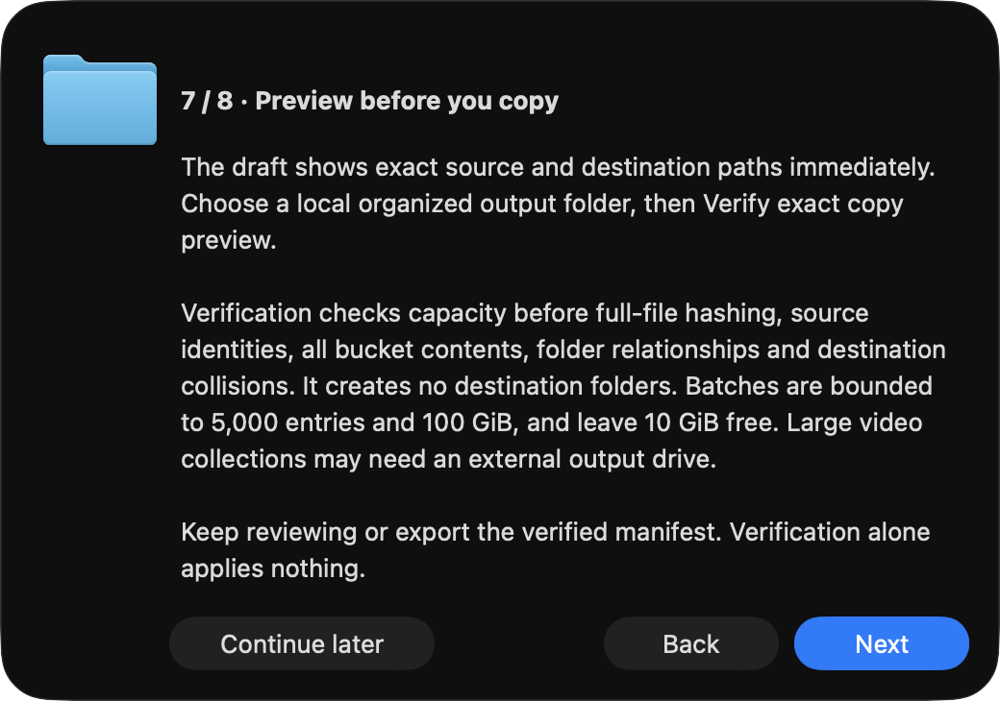{ loading=lazy decoding=async width="1040" height="730" }
<figcaption>Real native AppKit view populated exclusively by the invented documentation library; no personal catalogue or file content. Capture performs no approved copy.</figcaption>
</figure>

Capture: `--documentation-capture` · Version: `0.5.2` · Origin: `generated-documentation-library-v1` · SHA-256: `6f955a4bfdbb799206a666d06ebd09a2b8703989f2c1fd9a5de9c71d4abd908c`

## Welcome 8 · dark

<figure markdown>
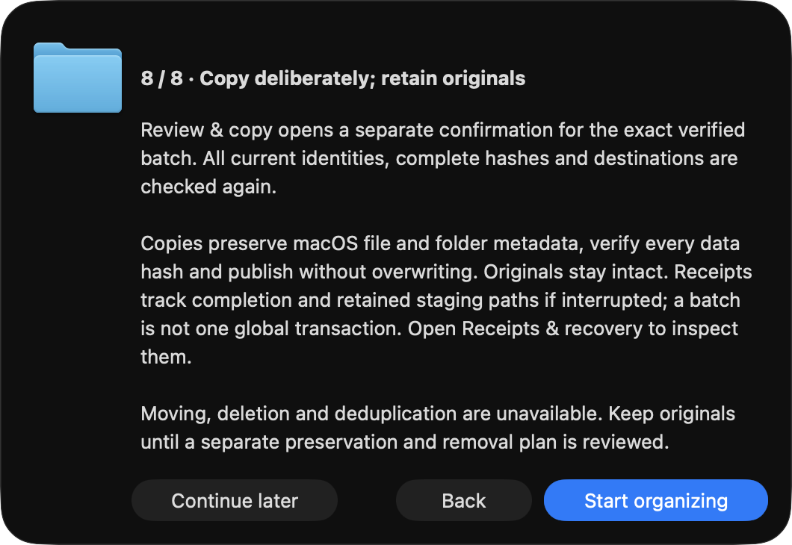{ loading=lazy decoding=async width="1060" height="730" }
<figcaption>Real native AppKit view populated exclusively by the invented documentation library; no personal catalogue or file content. Capture performs no approved copy.</figcaption>
</figure>

Capture: `--documentation-capture` · Version: `0.5.2` · Origin: `generated-documentation-library-v1` · SHA-256: `e158a1a6dee9abd42166da835e8628e40b84a1356f87a0cc4136746d31319961`

## Collections · light

<figure markdown>
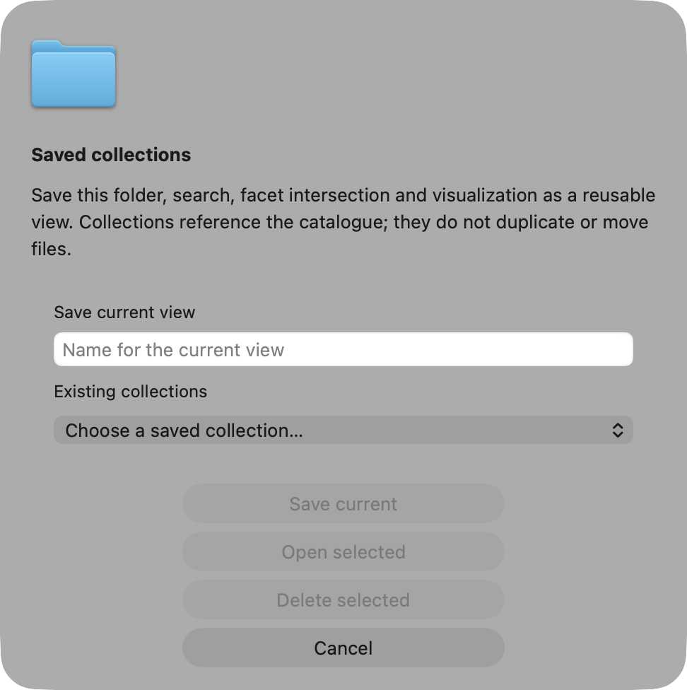{ loading=lazy decoding=async width="972" height="976" }
<figcaption>Real native AppKit view populated exclusively by the invented documentation library; no personal catalogue or file content. Capture performs no approved copy.</figcaption>
</figure>

Capture: `--documentation-capture` · Version: `0.5.2` · Origin: `generated-documentation-library-v1` · SHA-256: `0e12e3ddf5b96f4e853c33d615c7fab1bc389062127cbfa7e33d7a2b9898b196`

## Comparison · light

<figure markdown>
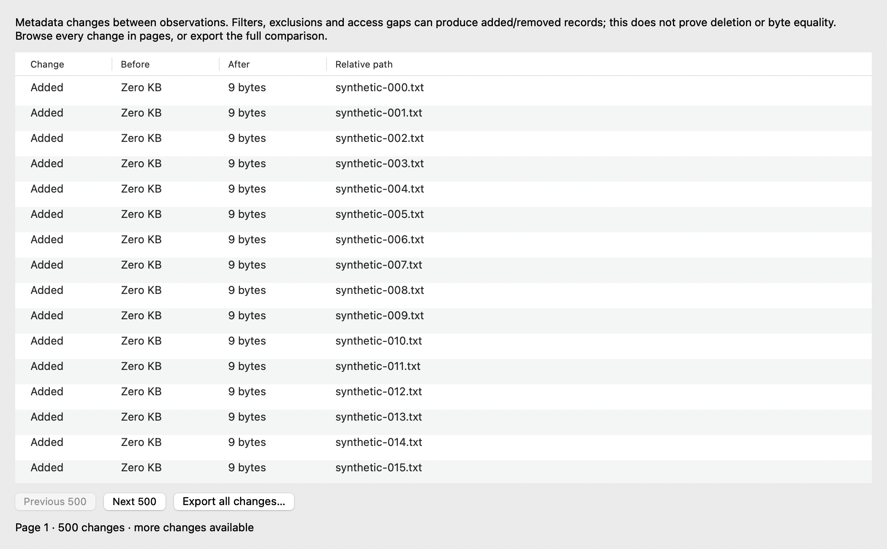{ loading=lazy decoding=async width="2100" height="1300" }
<figcaption>Synthetic metadata acceptance fixture with 601 added records; complete comparison paging remains available beyond the visible 500 rows. Earlier 0.4.2 layout; evidence behavior remains available in 0.5.0.</figcaption>
</figure>

Capture: `--review-ui-smoke` · Version: `0.4.2` · Origin: `synthetic-review-metadata-v1` · SHA-256: `5afab1ddc980edbba3da1e2f77498cf1dc405ee58603cbecae01f36dc5ceb035`

## Content Connections · light

<figure markdown>
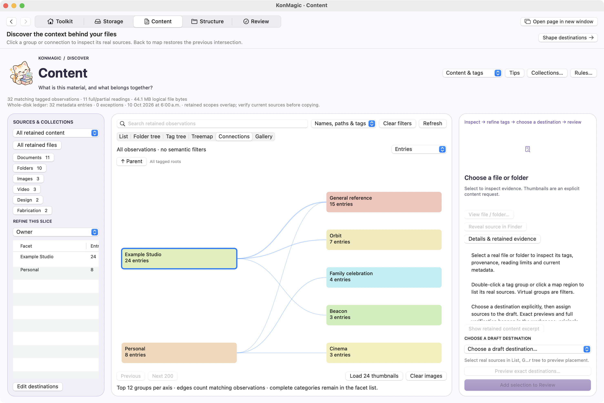{ loading=lazy decoding=async width="2960" height="1976" }
<figcaption>Real native AppKit view populated exclusively by the invented documentation library; no personal catalogue or file content. Capture performs no approved copy.</figcaption>
</figure>

Capture: `--documentation-capture` · Version: `0.5.2` · Origin: `generated-documentation-library-v1` · SHA-256: `381309f5ee79a518f381e5c3ddd8ad23cf1f76d7deef3c40e18b9381c398e324`

## Content Filters · light

<figure markdown>
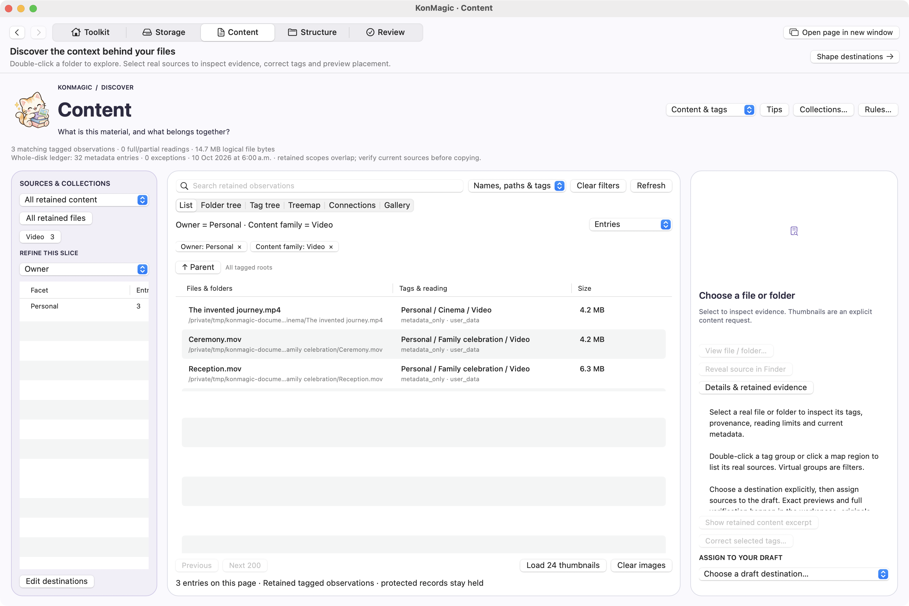{ loading=lazy decoding=async width="2960" height="1976" }
<figcaption>Real native AppKit view populated exclusively by the invented documentation library; no personal catalogue or file content. Capture performs no approved copy.</figcaption>
</figure>

Capture: `--documentation-capture` · Version: `0.5.2` · Origin: `generated-documentation-library-v1` · SHA-256: `b2b5ec53f57fb163af2af0ca1a0f366174baf8e91d8d5efc1a7c24dde8e70f18`

## Content Folder Tree · light

<figure markdown>
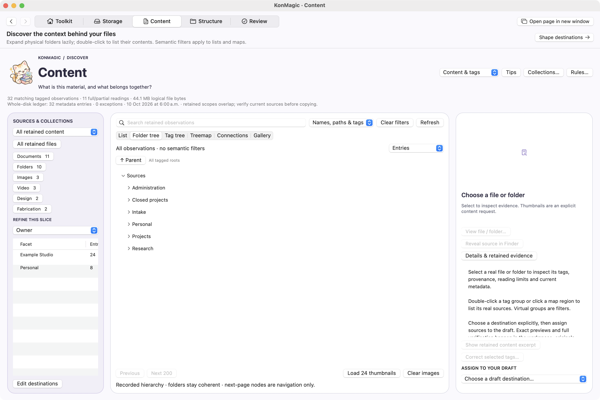{ loading=lazy decoding=async width="2960" height="1976" }
<figcaption>Real native AppKit view populated exclusively by the invented documentation library; no personal catalogue or file content. Capture performs no approved copy.</figcaption>
</figure>

Capture: `--documentation-capture` · Version: `0.5.2` · Origin: `generated-documentation-library-v1` · SHA-256: `dc897b07419c7ec65e933df73aaa0a8cf0f7cedce466bf564520aa04c0494597`

## Content Gallery Thumbnails · light

<figure markdown>
{ loading=lazy decoding=async width="2960" height="1976" }
<figcaption>Real native AppKit view populated exclusively by the invented documentation library; no personal catalogue or file content. Capture performs no approved copy.</figcaption>
</figure>

Capture: `--documentation-capture` · Version: `0.5.2` · Origin: `generated-documentation-library-v1` · SHA-256: `4aee4b20c2fe3d8a90b7dd31d841482175f70feae11d8d032a35153f9c2895c2`

## Content Gallery · light

<figure markdown>
{ loading=lazy decoding=async width="2960" height="1976" }
<figcaption>Real native AppKit view populated exclusively by the invented documentation library; no personal catalogue or file content. Capture performs no approved copy.</figcaption>
</figure>

Capture: `--documentation-capture` · Version: `0.5.2` · Origin: `generated-documentation-library-v1` · SHA-256: `811a1185a590e886f73a947a8021f09e379786dfdb66bee11681c5ab3499aa70`

## Content Inspector · light

<figure markdown>
{ loading=lazy decoding=async width="2960" height="1976" }
<figcaption>Real native AppKit view populated exclusively by the invented documentation library; no personal catalogue or file content. Capture performs no approved copy.</figcaption>
</figure>

Capture: `--documentation-capture` · Version: `0.5.2` · Origin: `generated-documentation-library-v1` · SHA-256: `0976b9bafcbfd861510b3d1abc2163e492dc4d394ef62223c760c4109538a837`

## Content List · light

<figure markdown>
{ loading=lazy decoding=async width="2960" height="1976" }
<figcaption>Real native AppKit view populated exclusively by the invented documentation library; no personal catalogue or file content. Capture performs no approved copy.</figcaption>
</figure>

Capture: `--documentation-capture` · Version: `0.5.2` · Origin: `generated-documentation-library-v1` · SHA-256: `a89b48783233b79c16ad75c39d6f70b613af799e54fa3e10a171b372bc66650c`

## Content Reading · light

<figure markdown>
{ loading=lazy decoding=async width="2960" height="1976" }
<figcaption>Real native AppKit view populated exclusively by the invented documentation library; no personal catalogue or file content. Capture performs no approved copy.</figcaption>
</figure>

Capture: `--documentation-capture` · Version: `0.5.2` · Origin: `generated-documentation-library-v1` · SHA-256: `0095ce5b3b708eaf899e9b6f93c19c16955e981410b3346bad8364193d447c19`

## Content Restored · light

<figure markdown>
{ loading=lazy decoding=async width="2960" height="1976" }
<figcaption>Real native AppKit view populated exclusively by the invented documentation library; no personal catalogue or file content. Capture performs no approved copy.</figcaption>
</figure>

Capture: `--documentation-capture` · Version: `0.5.2` · Origin: `generated-documentation-library-v1` · SHA-256: `ef418d3c42aced95328e8da47f9a2cd880d005ac8cd7c0673603e45b2817c83e`

## Content Tag Tree · light

<figure markdown>
{ loading=lazy decoding=async width="2960" height="1976" }
<figcaption>Real native AppKit view populated exclusively by the invented documentation library; no personal catalogue or file content. Capture performs no approved copy.</figcaption>
</figure>

Capture: `--documentation-capture` · Version: `0.5.2` · Origin: `generated-documentation-library-v1` · SHA-256: `5f8add17908a1a5002b9c65a6f0c0708028da0073345aaae43addd9bb9129c79`

## Content Treemap · light

<figure markdown>
{ loading=lazy decoding=async width="2960" height="1976" }
<figcaption>Real native AppKit view populated exclusively by the invented documentation library; no personal catalogue or file content. Capture performs no approved copy.</figcaption>
</figure>

Capture: `--documentation-capture` · Version: `0.5.2` · Origin: `generated-documentation-library-v1` · SHA-256: `765032561eaa75b929fff44453c316abdd2230719122cf6a312ce9208fe124de`

## Copy Confirmation · light

<figure markdown>
{ loading=lazy decoding=async width="520" height="836" }
<figcaption>Real native AppKit view populated exclusively by the invented documentation library; no personal catalogue or file content. Capture performs no approved copy.</figcaption>
</figure>

Capture: `--documentation-capture` · Version: `0.5.2` · Origin: `generated-documentation-library-v1` · SHA-256: `6fad849a99a6b297cc243d5c5d11649ae22c65160c5628946076e856cc5909ca`

## Create Rule · light

<figure markdown>
{ loading=lazy decoding=async width="1150" height="994" }
<figcaption>Real native AppKit view populated exclusively by the invented documentation library; no personal catalogue or file content. Capture performs no approved copy.</figcaption>
</figure>

Capture: `--documentation-capture` · Version: `0.5.2` · Origin: `generated-documentation-library-v1` · SHA-256: `d117603df731b47fef032e09ce8fb807fe2d48b8a8c4018316d565ee2b0f457a`

## Duplicates · light

<figure markdown>
{ loading=lazy decoding=async width="2100" height="1400" }
<figcaption>Synthetic equal-size candidate fixture with 601 invented records. It exceeds the 100-file proof bound and enables no automatic body hashing or deletion. Earlier 0.4.2 layout; evidence behavior remains available in 0.5.0.</figcaption>
</figure>

Capture: `--review-ui-smoke` · Version: `0.4.2` · Origin: `synthetic-review-metadata-v1` · SHA-256: `299d2b5ce6090df8a1996f6acfac00a1c4a955ddb015cfefd2ad85f67df4bf96`

## File Viewer · light

<figure markdown>
{ loading=lazy decoding=async width="2960" height="1976" }
<figcaption>Real native AppKit view populated exclusively by the invented documentation library; no personal catalogue or file content. Capture performs no approved copy.</figcaption>
</figure>

Capture: `--documentation-capture` · Version: `0.5.2` · Origin: `generated-documentation-library-v1` · SHA-256: `bcfa57cf5e99a18d237a1990ac15bac8df082757ad44174b3d7fb743880ef3c1`

## Folder Gallery · light

<figure markdown>
{ loading=lazy decoding=async width="2960" height="1976" }
<figcaption>Real native AppKit view populated exclusively by the invented documentation library; no personal catalogue or file content. Capture performs no approved copy.</figcaption>
</figure>

Capture: `--documentation-capture` · Version: `0.5.2` · Origin: `generated-documentation-library-v1` · SHA-256: `a9fd3e786180ff59860e9f0409af58531cc1c254a4496df90b9b3573baa73099`

## Folder Thumbnails · light

<figure markdown>
{ loading=lazy decoding=async width="2960" height="1976" }
<figcaption>Real native AppKit view populated exclusively by the invented documentation library; no personal catalogue or file content. Capture performs no approved copy.</figcaption>
</figure>

Capture: `--documentation-capture` · Version: `0.5.2` · Origin: `generated-documentation-library-v1` · SHA-256: `431a2e9ba0640cc68577f320d0ef7c71753ce981b52f8715acdb824563a62835`

## Folder Viewer · light

<figure markdown>
{ loading=lazy decoding=async width="2960" height="1976" }
<figcaption>Real native AppKit view populated exclusively by the invented documentation library; no personal catalogue or file content. Capture performs no approved copy.</figcaption>
</figure>

Capture: `--documentation-capture` · Version: `0.5.2` · Origin: `generated-documentation-library-v1` · SHA-256: `5d63125cef361d3e6546fbf9bba4403a8bf18a1a2941e31c91d6df2bb80c3399`

## Image Viewer · light

<figure markdown>
{ loading=lazy decoding=async width="2960" height="1976" }
<figcaption>Real native AppKit view populated exclusively by the invented documentation library; no personal catalogue or file content. Capture performs no approved copy.</figcaption>
</figure>

Capture: `--documentation-capture` · Version: `0.5.2` · Origin: `generated-documentation-library-v1` · SHA-256: `82bec38570c5fdb2930f2dc39e52cc471cc5a7925022f0090511be7883ad1878`

## Mask Editor · light

<figure markdown>
{ loading=lazy decoding=async width="1700" height="1196" }
<figcaption>Real native AppKit view populated exclusively by the invented documentation library; no personal catalogue or file content. Capture performs no approved copy.</figcaption>
</figure>

Capture: `--documentation-capture` · Version: `0.5.2` · Origin: `generated-documentation-library-v1` · SHA-256: `e8dbbafa01985345ea3b6fbbfc5367d977b31ac5fed0d2754425600b217fb991`

## New Folder · light

<figure markdown>
{ loading=lazy decoding=async width="992" height="850" }
<figcaption>Real native AppKit view populated exclusively by the invented documentation library; no personal catalogue or file content. Capture performs no approved copy.</figcaption>
</figure>

Capture: `--documentation-capture` · Version: `0.5.2` · Origin: `generated-documentation-library-v1` · SHA-256: `afb6b503a57aec39483be861cfd56d2a04630df82c19f1acd68bd74fcdcee73b`

## Placement Preview · light

<figure markdown>
{ loading=lazy decoding=async width="1504" height="1284" }
<figcaption>Real native AppKit view populated exclusively by the invented documentation library; no personal catalogue or file content. Capture performs no approved copy.</figcaption>
</figure>

Capture: `--documentation-capture` · Version: `0.5.2` · Origin: `generated-documentation-library-v1` · SHA-256: `e1eda5f611ece686f49d84c6677ab0bdbdfc6a90723971d5504c147598106dcc`

## Preferences · light

<figure markdown>
{ loading=lazy decoding=async width="992" height="692" }
<figcaption>Real native AppKit view populated exclusively by the invented documentation library; no personal catalogue or file content. Capture performs no approved copy.</figcaption>
</figure>

Capture: `--documentation-capture` · Version: `0.5.2` · Origin: `generated-documentation-library-v1` · SHA-256: `7edc1349cafc9a84892ab22c80d0d2feb545a09aff2b8d9312661ea6049a198f`

## Recorded Disk · light

<figure markdown>
{ loading=lazy decoding=async width="2960" height="1976" }
<figcaption>Real native AppKit view populated exclusively by the invented documentation library; no personal catalogue or file content. Capture performs no approved copy.</figcaption>
</figure>

Capture: `--documentation-capture` · Version: `0.5.2` · Origin: `generated-documentation-library-v1` · SHA-256: `9b6e441c5b2fdb24f9053dabd71fa48afd8a458a95ef907f95b1be5542ce939d`

## Review Unverified · light

<figure markdown>
{ loading=lazy decoding=async width="2960" height="1976" }
<figcaption>Real native AppKit view populated exclusively by the invented documentation library; no personal catalogue or file content. Capture performs no approved copy.</figcaption>
</figure>

Capture: `--documentation-capture` · Version: `0.5.2` · Origin: `generated-documentation-library-v1` · SHA-256: `9a235e077c043e15dd470b17c560166c319d90a574a144270e65a244406d59d4`

## Review Verified · light

<figure markdown>
{ loading=lazy decoding=async width="2960" height="1976" }
<figcaption>Exact preview verified against one small generated temporary file using the test-only fixture allowance. No copy is approved.</figcaption>
</figure>

Capture: `--documentation-capture` · Version: `0.5.2` · Origin: `generated-documentation-library-v1` · SHA-256: `684facf5b0b812ca851565b97fdd07e00c5c1c639914eee8d32041af84468701`

## Rules · light

<figure markdown>
{ loading=lazy decoding=async width="972" height="852" }
<figcaption>Real native AppKit view populated exclusively by the invented documentation library; no personal catalogue or file content. Capture performs no approved copy.</figcaption>
</figure>

Capture: `--documentation-capture` · Version: `0.5.2` · Origin: `generated-documentation-library-v1` · SHA-256: `f4fe8e0201bcdc733c6d9671cd2f43e916b23ba7dd946f9e38577aa43db50a0f`

## Scan Filters · light

<figure markdown>
{ loading=lazy decoding=async width="520" height="740" }
<figcaption>Real native AppKit view populated exclusively by the invented documentation library; no personal catalogue or file content. Capture performs no approved copy.</figcaption>
</figure>

Capture: `--documentation-capture` · Version: `0.5.2` · Origin: `generated-documentation-library-v1` · SHA-256: `ee2d2df82717deeb3ce54ecb14e3ebb9125a74f838326d0e1a13dfa7f4c06e9d`

## Scan Notes · light

<figure markdown>
{ loading=lazy decoding=async width="1064" height="628" }
<figcaption>Real native AppKit view populated exclusively by the invented documentation library; no personal catalogue or file content. Capture performs no approved copy.</figcaption>
</figure>

Capture: `--documentation-capture` · Version: `0.5.2` · Origin: `generated-documentation-library-v1` · SHA-256: `a772a3a46ccde13ea42a41b7f4b9f05c0b7efd7cd9fd0b6a2c1f5b7e1ef20b8a`

## Storage Focused · light

<figure markdown>
{ loading=lazy decoding=async width="2960" height="1976" }
<figcaption>Real native AppKit view populated exclusively by the invented documentation library; no personal catalogue or file content. Capture performs no approved copy.</figcaption>
</figure>

Capture: `--documentation-capture` · Version: `0.5.2` · Origin: `generated-documentation-library-v1` · SHA-256: `0e98eeb710c443d8e272ea60355f013fe5ad2101fe507ee33f8ca69f1d484b3e`

## Storage Map Focus · light

<figure markdown>
{ loading=lazy decoding=async width="2960" height="1976" }
<figcaption>Real native AppKit view populated exclusively by the invented documentation library; no personal catalogue or file content. Capture performs no approved copy.</figcaption>
</figure>

Capture: `--documentation-capture` · Version: `0.5.2` · Origin: `generated-documentation-library-v1` · SHA-256: `5e9146e8908e7b217a9f6fa41397db16f929b58b3e6e1cb12bc7e09955dcbb1a`

## Storage Map Inspector · light

<figure markdown>
{ loading=lazy decoding=async width="2960" height="1976" }
<figcaption>Real native AppKit view populated exclusively by the invented documentation library; no personal catalogue or file content. Capture performs no approved copy.</figcaption>
</figure>

Capture: `--documentation-capture` · Version: `0.5.2` · Origin: `generated-documentation-library-v1` · SHA-256: `1b014f03c07b42a82f6aba0fd16da2537006d78e624cbb1dbf1f2030a4d5d2c1`

## Storage Map Restored · light

<figure markdown>
{ loading=lazy decoding=async width="2960" height="1976" }
<figcaption>Real native AppKit view populated exclusively by the invented documentation library; no personal catalogue or file content. Capture performs no approved copy.</figcaption>
</figure>

Capture: `--documentation-capture` · Version: `0.5.2` · Origin: `generated-documentation-library-v1` · SHA-256: `0a18fd30ec34e476816b56f2f76800a0360d94a822f113155b84522aeec3406d`

## Storage Map Zoom · light

<figure markdown>
{ loading=lazy decoding=async width="2960" height="1976" }
<figcaption>Real native AppKit view populated exclusively by the invented documentation library; no personal catalogue or file content. Capture performs no approved copy.</figcaption>
</figure>

Capture: `--documentation-capture` · Version: `0.5.2` · Origin: `generated-documentation-library-v1` · SHA-256: `6660a663adc26b38d898b2ff2498fa8dadcd3a82c4865447adeaf6b3c64e042a`

## Storage Options · light

<figure markdown>
{ loading=lazy decoding=async width="2960" height="1976" }
<figcaption>Real native AppKit view populated exclusively by the invented documentation library; no personal catalogue or file content. Capture performs no approved copy.</figcaption>
</figure>

Capture: `--documentation-capture` · Version: `0.5.2` · Origin: `generated-documentation-library-v1` · SHA-256: `e492e9ca308ff7c6b22524d7f494d7ee56500ce6ec06e05ec7694c653b0c0e64`

## Storage · light

<figure markdown>
{ loading=lazy decoding=async width="2960" height="1976" }
<figcaption>Real native AppKit view populated exclusively by the invented documentation library; no personal catalogue or file content. Capture performs no approved copy.</figcaption>
</figure>

Capture: `--documentation-capture` · Version: `0.5.2` · Origin: `generated-documentation-library-v1` · SHA-256: `397ab4a26124c1130e8fedaf21fc82d1dc3c97f99f0b14d567c336eccc24cdec`

## Structure · light

<figure markdown>
{ loading=lazy decoding=async width="2960" height="1976" }
<figcaption>Real native AppKit view populated exclusively by the invented documentation library; no personal catalogue or file content. Capture performs no approved copy.</figcaption>
</figure>

Capture: `--documentation-capture` · Version: `0.5.2` · Origin: `generated-documentation-library-v1` · SHA-256: `64fedc977ae27f2c3e02855f241f8b73f615143a68a20ff75af562a8e60fdbd5`

## Tag Corrections · light

<figure markdown>
{ loading=lazy decoding=async width="1170" height="1184" }
<figcaption>Real native AppKit view populated exclusively by the invented documentation library; no personal catalogue or file content. Capture performs no approved copy.</figcaption>
</figure>

Capture: `--documentation-capture` · Version: `0.5.2` · Origin: `generated-documentation-library-v1` · SHA-256: `0ae2be60bfeaa5ff31129852423a4648d6009389edde16310fe2c2bcc6427c22`

## Toolkit · light

<figure markdown>
{ loading=lazy decoding=async width="2960" height="1976" }
<figcaption>Real native AppKit view populated exclusively by the invented documentation library; no personal catalogue or file content. Capture performs no approved copy.</figcaption>
</figure>

Capture: `--documentation-capture` · Version: `0.5.2` · Origin: `generated-documentation-library-v1` · SHA-256: `1ce68de7bfba972d0d8debf25699ae674da0b60cccd740f2adfa133492173d37`

## Welcome 1 · light

<figure markdown>
{ loading=lazy decoding=async width="1040" height="1072" }
<figcaption>Real native AppKit view populated exclusively by the invented documentation library; no personal catalogue or file content. Capture performs no approved copy.</figcaption>
</figure>

Capture: `--documentation-capture` · Version: `0.5.2` · Origin: `generated-documentation-library-v1` · SHA-256: `b941625d41136509782f65fb8e3106437a35159109d4b106a881982b50bb2e9c`

## Welcome 2 · light

<figure markdown>
{ loading=lazy decoding=async width="1040" height="654" }
<figcaption>Real native AppKit view populated exclusively by the invented documentation library; no personal catalogue or file content. Capture performs no approved copy.</figcaption>
</figure>

Capture: `--documentation-capture` · Version: `0.5.2` · Origin: `generated-documentation-library-v1` · SHA-256: `f8b26d7f933fe2ab308ce4469157eccb23a411198457e661e484c4b84c8a9686`

## Welcome 3 · light

<figure markdown>
{ loading=lazy decoding=async width="1040" height="654" }
<figcaption>Real native AppKit view populated exclusively by the invented documentation library; no personal catalogue or file content. Capture performs no approved copy.</figcaption>
</figure>

Capture: `--documentation-capture` · Version: `0.5.2` · Origin: `generated-documentation-library-v1` · SHA-256: `5a853b52cca6cf3e948e0e033d86bcadfdea9019f8d93e1583304386bf02aefe`

## Welcome 4 · light

<figure markdown>
{ loading=lazy decoding=async width="1040" height="730" }
<figcaption>Real native AppKit view populated exclusively by the invented documentation library; no personal catalogue or file content. Capture performs no approved copy.</figcaption>
</figure>

Capture: `--documentation-capture` · Version: `0.5.2` · Origin: `generated-documentation-library-v1` · SHA-256: `3442761786e9d8e241ccf12d1b550b83bd83d9f8bc51d182aed11b9f6bb2e1d7`

## Welcome 5 · light

<figure markdown>
{ loading=lazy decoding=async width="1040" height="1186" }
<figcaption>Real native AppKit view populated exclusively by the invented documentation library; no personal catalogue or file content. Capture performs no approved copy.</figcaption>
</figure>

Capture: `--documentation-capture` · Version: `0.5.2` · Origin: `generated-documentation-library-v1` · SHA-256: `d655f2d38223996288a2a6a4ee6021d6463c8fb76bbbc70b09008fd40ffdf8c5`

## Welcome 6 · light

<figure markdown>
{ loading=lazy decoding=async width="1040" height="1376" }
<figcaption>Real native AppKit view populated exclusively by the invented documentation library; no personal catalogue or file content. Capture performs no approved copy.</figcaption>
</figure>

Capture: `--documentation-capture` · Version: `0.5.2` · Origin: `generated-documentation-library-v1` · SHA-256: `944780daf601e0b1ac986b62cde976bb0bb396cbf97811b73ef983326c4c7949`

## Welcome 7 · light

<figure markdown>
{ loading=lazy decoding=async width="1040" height="730" }
<figcaption>Real native AppKit view populated exclusively by the invented documentation library; no personal catalogue or file content. Capture performs no approved copy.</figcaption>
</figure>

Capture: `--documentation-capture` · Version: `0.5.2` · Origin: `generated-documentation-library-v1` · SHA-256: `2685bec095ec04b39e191d21a719b0f0214c14ab199ca6ad9310c520a0ba597b`

## Welcome 8 · light

<figure markdown>
{ loading=lazy decoding=async width="1060" height="730" }
<figcaption>Real native AppKit view populated exclusively by the invented documentation library; no personal catalogue or file content. Capture performs no approved copy.</figcaption>
</figure>

Capture: `--documentation-capture` · Version: `0.5.2` · Origin: `generated-documentation-library-v1` · SHA-256: `b60c81d6c43d39edc905855a2723fb2d729ea407dd022cb71cf0fc942f5f6113`
