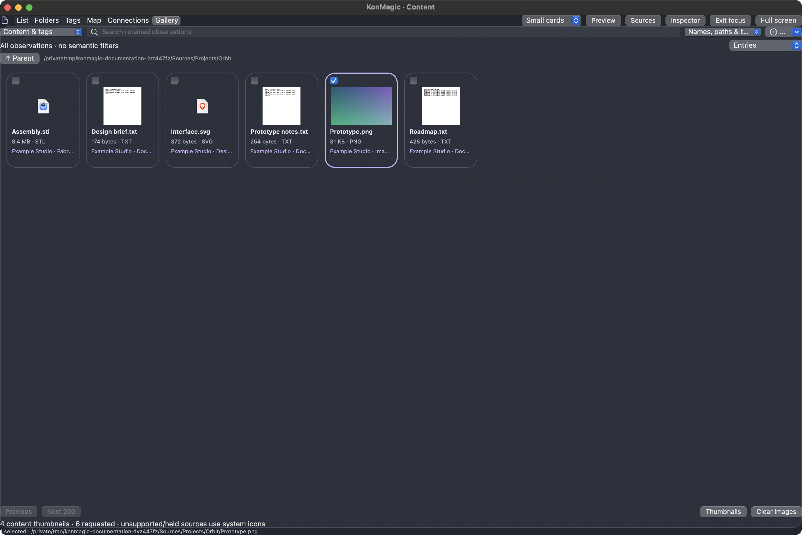
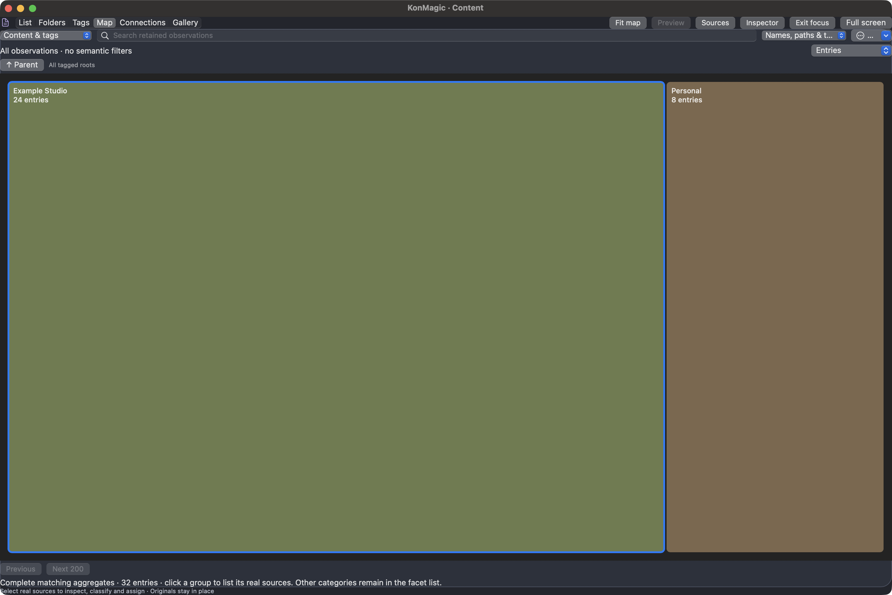
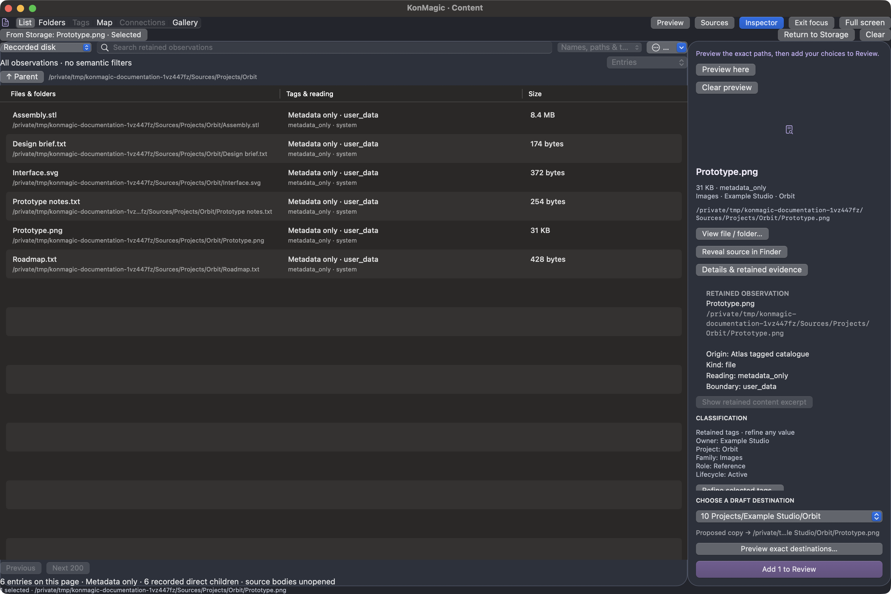
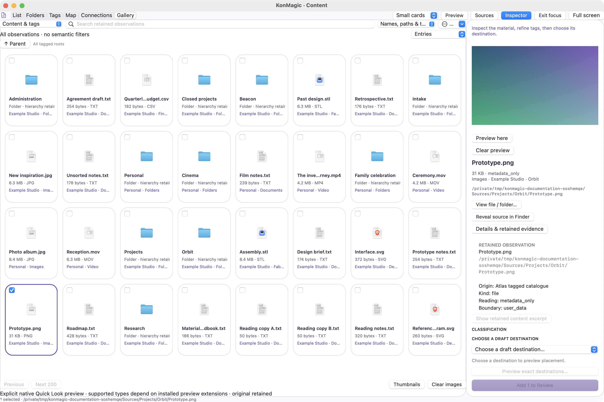
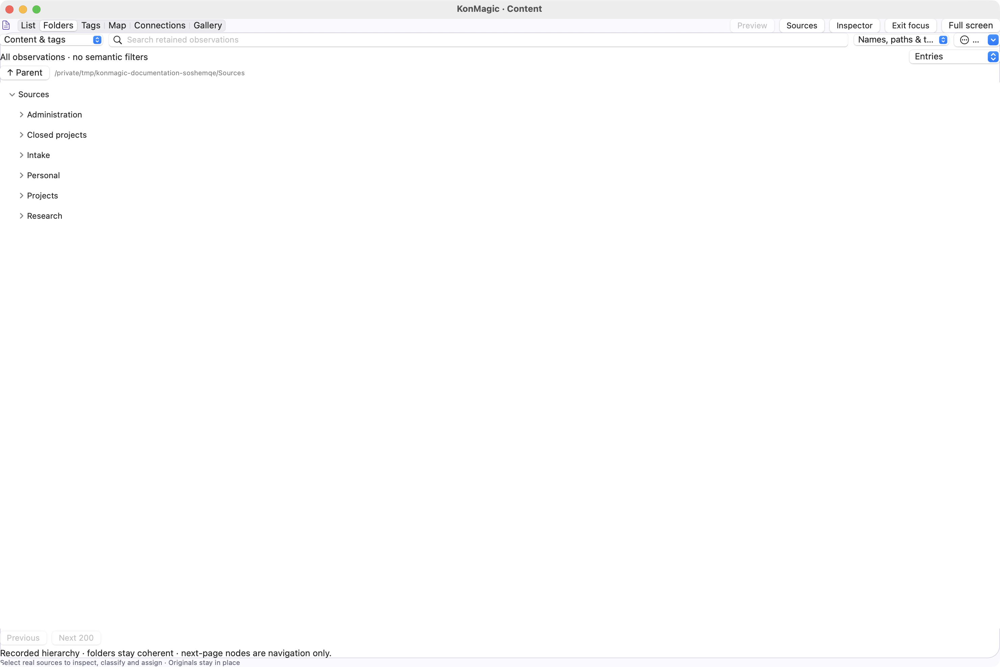

# Screenshot atlas

**106 native screenshots · KonMagic 0.5.3 · entirely invented fixture data.**

All images depict real AppKit views. Example sources, tags and readings are synthetic. No ordinary local QA image or personal catalogue is included. Enlarge images with the image button; Escape closes the viewer. See [testing/capture workflow](../developer/testing.md) and [documentation maintenance](../developer/documentation.md).

## Collections · dark

<figure markdown>
{ loading=lazy decoding=async width="972" height="976" }
<figcaption>Real native AppKit view populated exclusively by the invented documentation library; no personal catalogue or file content. Capture performs no approved copy.</figcaption>
</figure>

Capture: `--documentation-capture` · Version: `0.5.3` · Origin: `generated-documentation-library-v1` · SHA-256: `97a107e53cc0c9fbc351c1a0d0c0553aa40d15b523ab1eba7b81110ddc26a5d1`

## Content Connections · dark

<figure markdown>
{ loading=lazy decoding=async width="2960" height="1976" }
<figcaption>Real native AppKit view populated exclusively by the invented documentation library; no personal catalogue or file content. Capture performs no approved copy.</figcaption>
</figure>

Capture: `--documentation-capture` · Version: `0.5.3` · Origin: `generated-documentation-library-v1` · SHA-256: `be53471908fcd384abfba4ee8b5ff612ca0832a7dafcf1db2cc46c1f267b187c`

## Content Filters · dark

<figure markdown>
{ loading=lazy decoding=async width="2960" height="1976" }
<figcaption>Real native AppKit view populated exclusively by the invented documentation library; no personal catalogue or file content. Capture performs no approved copy.</figcaption>
</figure>

Capture: `--documentation-capture` · Version: `0.5.3` · Origin: `generated-documentation-library-v1` · SHA-256: `716a2fb86f6cd437fa343adc86fae7bee044baddc760ac92db3d1ef8d25b88c8`

## Content Folder Tree · dark

<figure markdown>
{ loading=lazy decoding=async width="2960" height="1976" }
<figcaption>Real native AppKit view populated exclusively by the invented documentation library; no personal catalogue or file content. Capture performs no approved copy.</figcaption>
</figure>

Capture: `--documentation-capture` · Version: `0.5.3` · Origin: `generated-documentation-library-v1` · SHA-256: `e128bee80e673afe03e8b1952bf8fc34d78954bf5325734f9ab6b7b1226650c7`

## Content Gallery Thumbnails · dark

<figure markdown>
{ loading=lazy decoding=async width="2960" height="1976" }
<figcaption>Real native AppKit view populated exclusively by the invented documentation library; no personal catalogue or file content. Capture performs no approved copy.</figcaption>
</figure>

Capture: `--documentation-capture` · Version: `0.5.3` · Origin: `generated-documentation-library-v1` · SHA-256: `653561a6a897f90dbfe4d32f514eb4a45ace1af4e37c81a564672da770c358e4`

## Content Gallery · dark

<figure markdown>
{ loading=lazy decoding=async width="2960" height="1976" }
<figcaption>Real native AppKit view populated exclusively by the invented documentation library; no personal catalogue or file content. Capture performs no approved copy.</figcaption>
</figure>

Capture: `--documentation-capture` · Version: `0.5.3` · Origin: `generated-documentation-library-v1` · SHA-256: `54072808688285d4b7b0dc8b442929b1dfa75597fe163c5f2a4fa4c838359900`

## Content Inspector · dark

<figure markdown>
{ loading=lazy decoding=async width="2960" height="1976" }
<figcaption>Real native AppKit view populated exclusively by the invented documentation library; no personal catalogue or file content. Capture performs no approved copy.</figcaption>
</figure>

Capture: `--documentation-capture` · Version: `0.5.3` · Origin: `generated-documentation-library-v1` · SHA-256: `cf02dca4380ebc39b90a0c75ecdedf97519e16bf52b556dd9090a61315bf3eea`

## Content List · dark

<figure markdown>
{ loading=lazy decoding=async width="2960" height="1976" }
<figcaption>Real native AppKit view populated exclusively by the invented documentation library; no personal catalogue or file content. Capture performs no approved copy.</figcaption>
</figure>

Capture: `--documentation-capture` · Version: `0.5.3` · Origin: `generated-documentation-library-v1` · SHA-256: `29855fa0f6baeadedc3d7d187b362533f254e04096704102a06285bedcc741d5`

## Content Reading · dark

<figure markdown>
{ loading=lazy decoding=async width="2960" height="1976" }
<figcaption>Real native AppKit view populated exclusively by the invented documentation library; no personal catalogue or file content. Capture performs no approved copy.</figcaption>
</figure>

Capture: `--documentation-capture` · Version: `0.5.3` · Origin: `generated-documentation-library-v1` · SHA-256: `09a8a78e00293614d9d92e34633c40e9a20bab0295d0abf7ffb22003a4cae876`

## Content Restored · dark

<figure markdown>
{ loading=lazy decoding=async width="2960" height="1976" }
<figcaption>Real native AppKit view populated exclusively by the invented documentation library; no personal catalogue or file content. Capture performs no approved copy.</figcaption>
</figure>

Capture: `--documentation-capture` · Version: `0.5.3` · Origin: `generated-documentation-library-v1` · SHA-256: `eac29942ae429d9c51211de149ce19b9d75ff49de99f9d75fee5bc79e00cffb5`

## Content Tag Tree · dark

<figure markdown>
{ loading=lazy decoding=async width="2960" height="1976" }
<figcaption>Real native AppKit view populated exclusively by the invented documentation library; no personal catalogue or file content. Capture performs no approved copy.</figcaption>
</figure>

Capture: `--documentation-capture` · Version: `0.5.3` · Origin: `generated-documentation-library-v1` · SHA-256: `905166be52dd7685d1d0464f0d035ed55560b00c8fd204c47107a9d54c315407`

## Content Treemap · dark

<figure markdown>
{ loading=lazy decoding=async width="2960" height="1976" }
<figcaption>Real native AppKit view populated exclusively by the invented documentation library; no personal catalogue or file content. Capture performs no approved copy.</figcaption>
</figure>

Capture: `--documentation-capture` · Version: `0.5.3` · Origin: `generated-documentation-library-v1` · SHA-256: `52c28a03fd5a633ee6860e1c43e14d42e2e1ca09f39fc1651792b77832479bac`

## Content Workspace Focus · dark

<figure markdown>
{ loading=lazy decoding=async width="2960" height="1976" }
<figcaption>Real native AppKit view populated exclusively by the invented documentation library; no personal catalogue or file content. Capture performs no approved copy.</figcaption>
</figure>

Capture: `--documentation-capture` · Version: `0.5.3` · Origin: `generated-documentation-library-v1` · SHA-256: `9feb76a37bac5f79f029146ca2f75ff7e56f210e0be7d1ba52d17d4a1179c07f`

## Content Workspace Map · dark

<figure markdown>
{ loading=lazy decoding=async width="2960" height="1976" }
<figcaption>Real native AppKit view populated exclusively by the invented documentation library; no personal catalogue or file content. Capture performs no approved copy.</figcaption>
</figure>

Capture: `--documentation-capture` · Version: `0.5.3` · Origin: `generated-documentation-library-v1` · SHA-256: `144b6fb2886f9c5546b0eb79d6cc67aec78c8f77f7022bf994bdc7b50b7a3501`

## Content Workspace Preview · dark

<figure markdown>
{ loading=lazy decoding=async width="2960" height="1976" }
<figcaption>Real native AppKit view populated exclusively by the invented documentation library; no personal catalogue or file content. Capture performs no approved copy.</figcaption>
</figure>

Capture: `--documentation-capture` · Version: `0.5.3` · Origin: `generated-documentation-library-v1` · SHA-256: `b4b4a5d5c0d3e63cba52d2bcf91abb459aa42c89753e762223f60dda0228b275`

## Content Workspace Tree · dark

<figure markdown>
{ loading=lazy decoding=async width="2960" height="1976" }
<figcaption>Real native AppKit view populated exclusively by the invented documentation library; no personal catalogue or file content. Capture performs no approved copy.</figcaption>
</figure>

Capture: `--documentation-capture` · Version: `0.5.3` · Origin: `generated-documentation-library-v1` · SHA-256: `13837a820ea83283f562ab0ad82a6d9db48d826dc5f80105340d607e07035e74`

## Copy Confirmation · dark

<figure markdown>
{ loading=lazy decoding=async width="520" height="836" }
<figcaption>Real native AppKit view populated exclusively by the invented documentation library; no personal catalogue or file content. Capture performs no approved copy.</figcaption>
</figure>

Capture: `--documentation-capture` · Version: `0.5.3` · Origin: `generated-documentation-library-v1` · SHA-256: `5cc2cb3c4f7db1e193f9439353e7d10f4df994ba5572508c6630f40b0d40142a`

## Create Rule · dark

<figure markdown>
{ loading=lazy decoding=async width="1150" height="994" }
<figcaption>Real native AppKit view populated exclusively by the invented documentation library; no personal catalogue or file content. Capture performs no approved copy.</figcaption>
</figure>

Capture: `--documentation-capture` · Version: `0.5.3` · Origin: `generated-documentation-library-v1` · SHA-256: `533d4e658f3213f1b7218c63595ee6a7ecffed65dc282fc2db85467426bf937c`

## File Viewer · dark

<figure markdown>
{ loading=lazy decoding=async width="2960" height="1976" }
<figcaption>Real native AppKit view populated exclusively by the invented documentation library; no personal catalogue or file content. Capture performs no approved copy.</figcaption>
</figure>

Capture: `--documentation-capture` · Version: `0.5.3` · Origin: `generated-documentation-library-v1` · SHA-256: `d478c035ff97e27a58b022a9e2ac4a86732f66e03afc0cd53279db0be921444a`

## Folder Gallery · dark

<figure markdown>
{ loading=lazy decoding=async width="2960" height="1976" }
<figcaption>Real native AppKit view populated exclusively by the invented documentation library; no personal catalogue or file content. Capture performs no approved copy.</figcaption>
</figure>

Capture: `--documentation-capture` · Version: `0.5.3` · Origin: `generated-documentation-library-v1` · SHA-256: `e7fc02e4e21c27106ada7720559f8fe11fd8703753fa7fd4c7a8a70477d337d6`

## Folder Thumbnails · dark

<figure markdown>
{ loading=lazy decoding=async width="2960" height="1976" }
<figcaption>Real native AppKit view populated exclusively by the invented documentation library; no personal catalogue or file content. Capture performs no approved copy.</figcaption>
</figure>

Capture: `--documentation-capture` · Version: `0.5.3` · Origin: `generated-documentation-library-v1` · SHA-256: `affdebc7b10c6d598a1f668733f1c99f84161fa843c8bacbf1c9128325f48efd`

## Folder Viewer · dark

<figure markdown>
{ loading=lazy decoding=async width="2960" height="1976" }
<figcaption>Real native AppKit view populated exclusively by the invented documentation library; no personal catalogue or file content. Capture performs no approved copy.</figcaption>
</figure>

Capture: `--documentation-capture` · Version: `0.5.3` · Origin: `generated-documentation-library-v1` · SHA-256: `027d2519e01c1c99cf329b7d11fb954c840686dadd287672a30d655ca76c8fbd`

## Image Viewer · dark

<figure markdown>
{ loading=lazy decoding=async width="2960" height="1976" }
<figcaption>Real native AppKit view populated exclusively by the invented documentation library; no personal catalogue or file content. Capture performs no approved copy.</figcaption>
</figure>

Capture: `--documentation-capture` · Version: `0.5.3` · Origin: `generated-documentation-library-v1` · SHA-256: `96d61097b7c07cc9a4c5c55ee02a9913139ae64b04edc1ae283bac7d699e96f1`

## Mask Editor · dark

<figure markdown>
{ loading=lazy decoding=async width="1700" height="1196" }
<figcaption>Real native AppKit view populated exclusively by the invented documentation library; no personal catalogue or file content. Capture performs no approved copy.</figcaption>
</figure>

Capture: `--documentation-capture` · Version: `0.5.3` · Origin: `generated-documentation-library-v1` · SHA-256: `f94701c8b2715c306fd8de7d7c80d3c26ceb3838d791a94c8680c6887dffa273`

## New Folder · dark

<figure markdown>
{ loading=lazy decoding=async width="992" height="850" }
<figcaption>Real native AppKit view populated exclusively by the invented documentation library; no personal catalogue or file content. Capture performs no approved copy.</figcaption>
</figure>

Capture: `--documentation-capture` · Version: `0.5.3` · Origin: `generated-documentation-library-v1` · SHA-256: `4955ebd6b53707f460ba02578b8b708c24bb58e2cbbe72c126e8d0249f4e1338`

## Placement Preview · dark

<figure markdown>
{ loading=lazy decoding=async width="1504" height="1284" }
<figcaption>Real native AppKit view populated exclusively by the invented documentation library; no personal catalogue or file content. Capture performs no approved copy.</figcaption>
</figure>

Capture: `--documentation-capture` · Version: `0.5.3` · Origin: `generated-documentation-library-v1` · SHA-256: `a0cf8150e2007c0dad91ff87bd9cb15cf0f1c9c00ab69b11c16bab3a8c5c90b4`

## Preferences · dark

<figure markdown>
{ loading=lazy decoding=async width="992" height="692" }
<figcaption>Real native AppKit view populated exclusively by the invented documentation library; no personal catalogue or file content. Capture performs no approved copy.</figcaption>
</figure>

Capture: `--documentation-capture` · Version: `0.5.3` · Origin: `generated-documentation-library-v1` · SHA-256: `eb8f064ea4d116cd73f652c2cb64e6c765252dedb0a2f666c2556f47797cf7ec`

## Recorded Disk · dark

<figure markdown>
{ loading=lazy decoding=async width="2960" height="1976" }
<figcaption>Real native AppKit view populated exclusively by the invented documentation library; no personal catalogue or file content. Capture performs no approved copy.</figcaption>
</figure>

Capture: `--documentation-capture` · Version: `0.5.3` · Origin: `generated-documentation-library-v1` · SHA-256: `3d9e01c1b38122c17669096a7fa12ff98d663d0c0540c7ff11ddb2a69a482424`

## Review Unverified · dark

<figure markdown>
{ loading=lazy decoding=async width="2960" height="1976" }
<figcaption>Real native AppKit view populated exclusively by the invented documentation library; no personal catalogue or file content. Capture performs no approved copy.</figcaption>
</figure>

Capture: `--documentation-capture` · Version: `0.5.3` · Origin: `generated-documentation-library-v1` · SHA-256: `33c185b4302fd0b2db1fddb0bca48a09b9f2efdf956f9e0e7b7fbece1daa0bae`

## Review Verified · dark

<figure markdown>
{ loading=lazy decoding=async width="2960" height="1976" }
<figcaption>Exact preview verified against one small generated temporary file using the test-only fixture allowance. No copy is approved.</figcaption>
</figure>

Capture: `--documentation-capture` · Version: `0.5.3` · Origin: `generated-documentation-library-v1` · SHA-256: `aa6cee5892d99cf224270a8125e34667c1189d0f5f4c7cd3245330717b6494f8`

## Rules · dark

<figure markdown>
{ loading=lazy decoding=async width="972" height="852" }
<figcaption>Real native AppKit view populated exclusively by the invented documentation library; no personal catalogue or file content. Capture performs no approved copy.</figcaption>
</figure>

Capture: `--documentation-capture` · Version: `0.5.3` · Origin: `generated-documentation-library-v1` · SHA-256: `6e49fa2a86a00198e543ea6f452388036e035b345e083701601b05a9a11a1c2f`

## Scan Filters · dark

<figure markdown>
{ loading=lazy decoding=async width="520" height="740" }
<figcaption>Real native AppKit view populated exclusively by the invented documentation library; no personal catalogue or file content. Capture performs no approved copy.</figcaption>
</figure>

Capture: `--documentation-capture` · Version: `0.5.3` · Origin: `generated-documentation-library-v1` · SHA-256: `c28e91315402d2aaaf5780d9e47c47ceec12c5333988d8f4d90c667286f70a4d`

## Scan Notes · dark

<figure markdown>
{ loading=lazy decoding=async width="1064" height="628" }
<figcaption>Real native AppKit view populated exclusively by the invented documentation library; no personal catalogue or file content. Capture performs no approved copy.</figcaption>
</figure>

Capture: `--documentation-capture` · Version: `0.5.3` · Origin: `generated-documentation-library-v1` · SHA-256: `028f7879f485d506b767032d028b9bfc00183baca79282e9a3b27a70a476129d`

## Storage Content Handoff · dark

<figure markdown>
{ loading=lazy decoding=async width="2960" height="1976" }
<figcaption>Real native AppKit view populated exclusively by the invented documentation library; no personal catalogue or file content. Capture performs no approved copy.</figcaption>
</figure>

Capture: `--documentation-capture` · Version: `0.5.3` · Origin: `generated-documentation-library-v1` · SHA-256: `70531d8df896d050fbabbac74503b1e3f13fb0ede52fdcf067f493a1062a1ef8`

## Storage Focused · dark

<figure markdown>
{ loading=lazy decoding=async width="2960" height="1976" }
<figcaption>Real native AppKit view populated exclusively by the invented documentation library; no personal catalogue or file content. Capture performs no approved copy.</figcaption>
</figure>

Capture: `--documentation-capture` · Version: `0.5.3` · Origin: `generated-documentation-library-v1` · SHA-256: `d6f699e4482eef953dbb0e4d99d08a334e513a7709e0f215b9186e52c255e44e`

## Storage Map Focus · dark

<figure markdown>
{ loading=lazy decoding=async width="2960" height="1976" }
<figcaption>Real native AppKit view populated exclusively by the invented documentation library; no personal catalogue or file content. Capture performs no approved copy.</figcaption>
</figure>

Capture: `--documentation-capture` · Version: `0.5.3` · Origin: `generated-documentation-library-v1` · SHA-256: `a56108956359d17713bbcca498ebbdd58d27bbb87c02a1468667f6f2b23c7350`

## Storage Map Inspector · dark

<figure markdown>
{ loading=lazy decoding=async width="2960" height="1976" }
<figcaption>Real native AppKit view populated exclusively by the invented documentation library; no personal catalogue or file content. Capture performs no approved copy.</figcaption>
</figure>

Capture: `--documentation-capture` · Version: `0.5.3` · Origin: `generated-documentation-library-v1` · SHA-256: `4f31872fb1b8a481616d9c1b2044d1944ba2030c67a824daa8114a471e929a27`

## Storage Map Restored · dark

<figure markdown>
{ loading=lazy decoding=async width="2960" height="1976" }
<figcaption>Real native AppKit view populated exclusively by the invented documentation library; no personal catalogue or file content. Capture performs no approved copy.</figcaption>
</figure>

Capture: `--documentation-capture` · Version: `0.5.3` · Origin: `generated-documentation-library-v1` · SHA-256: `d64f1ad5528b2e9535156efcc092e3b079ccad4bdae4a5e716c65188d3f4fe08`

## Storage Map Zoom · dark

<figure markdown>
{ loading=lazy decoding=async width="2960" height="1976" }
<figcaption>Real native AppKit view populated exclusively by the invented documentation library; no personal catalogue or file content. Capture performs no approved copy.</figcaption>
</figure>

Capture: `--documentation-capture` · Version: `0.5.3` · Origin: `generated-documentation-library-v1` · SHA-256: `dc1f3301cefab672bdbc6d81aef184802f6d0a725cf620b58fe5da4696b674d3`

## Storage Options · dark

<figure markdown>
{ loading=lazy decoding=async width="2960" height="1976" }
<figcaption>Real native AppKit view populated exclusively by the invented documentation library; no personal catalogue or file content. Capture performs no approved copy.</figcaption>
</figure>

Capture: `--documentation-capture` · Version: `0.5.3` · Origin: `generated-documentation-library-v1` · SHA-256: `69c92c82a248dc01c7f4f5c5096c8197500f69b64ed02fe06763e4b01d29e8c2`

## Storage · dark

<figure markdown>
{ loading=lazy decoding=async width="2960" height="1976" }
<figcaption>Real native AppKit view populated exclusively by the invented documentation library; no personal catalogue or file content. Capture performs no approved copy.</figcaption>
</figure>

Capture: `--documentation-capture` · Version: `0.5.3` · Origin: `generated-documentation-library-v1` · SHA-256: `18f82eaffd588e21d87139a55cb51e8e6cd0eca5f6fb1fa12dcb10813f716714`

## Structure · dark

<figure markdown>
{ loading=lazy decoding=async width="2960" height="1976" }
<figcaption>Real native AppKit view populated exclusively by the invented documentation library; no personal catalogue or file content. Capture performs no approved copy.</figcaption>
</figure>

Capture: `--documentation-capture` · Version: `0.5.3` · Origin: `generated-documentation-library-v1` · SHA-256: `91ef90c19299153a835fe607561b2c9179bdb4a08315f2d264d9af33293b5090`

## Tag Corrections · dark

<figure markdown>
{ loading=lazy decoding=async width="1170" height="1184" }
<figcaption>Real native AppKit view populated exclusively by the invented documentation library; no personal catalogue or file content. Capture performs no approved copy.</figcaption>
</figure>

Capture: `--documentation-capture` · Version: `0.5.3` · Origin: `generated-documentation-library-v1` · SHA-256: `9522d795ac25905ee2362a9566e0f926b508e038607e37b09c0176f40ccea725`

## Toolkit · dark

<figure markdown>
{ loading=lazy decoding=async width="2960" height="1976" }
<figcaption>Real native AppKit view populated exclusively by the invented documentation library; no personal catalogue or file content. Capture performs no approved copy.</figcaption>
</figure>

Capture: `--documentation-capture` · Version: `0.5.3` · Origin: `generated-documentation-library-v1` · SHA-256: `269335bf570d26d074f57fa54ab7495243aa23523fcca940ef2ec4ed9010fd9e`

## Welcome 1 · dark

<figure markdown>
{ loading=lazy decoding=async width="1040" height="1072" }
<figcaption>Real native AppKit view populated exclusively by the invented documentation library; no personal catalogue or file content. Capture performs no approved copy.</figcaption>
</figure>

Capture: `--documentation-capture` · Version: `0.5.3` · Origin: `generated-documentation-library-v1` · SHA-256: `dd3dfc084fe2d45d5a2810d925c9c4adabc477c204ecc70081ace7abd480de56`

## Welcome 2 · dark

<figure markdown>
{ loading=lazy decoding=async width="1040" height="654" }
<figcaption>Real native AppKit view populated exclusively by the invented documentation library; no personal catalogue or file content. Capture performs no approved copy.</figcaption>
</figure>

Capture: `--documentation-capture` · Version: `0.5.3` · Origin: `generated-documentation-library-v1` · SHA-256: `6842de5b5d8439757571762c82f83960f92a303241adde368709467ddfcd6dff`

## Welcome 3 · dark

<figure markdown>
{ loading=lazy decoding=async width="1040" height="654" }
<figcaption>Real native AppKit view populated exclusively by the invented documentation library; no personal catalogue or file content. Capture performs no approved copy.</figcaption>
</figure>

Capture: `--documentation-capture` · Version: `0.5.3` · Origin: `generated-documentation-library-v1` · SHA-256: `883a10971016deea7d439603ceb19e153c08495903b9f9e4fe6b3c5e2cc796c9`

## Welcome 4 · dark

<figure markdown>
{ loading=lazy decoding=async width="1040" height="730" }
<figcaption>Real native AppKit view populated exclusively by the invented documentation library; no personal catalogue or file content. Capture performs no approved copy.</figcaption>
</figure>

Capture: `--documentation-capture` · Version: `0.5.3` · Origin: `generated-documentation-library-v1` · SHA-256: `bfbca6aef185894153e35befeca7598d5dec94cd6d517348e9964f013dc1ae61`

## Welcome 5 · dark

<figure markdown>
{ loading=lazy decoding=async width="1040" height="1186" }
<figcaption>Real native AppKit view populated exclusively by the invented documentation library; no personal catalogue or file content. Capture performs no approved copy.</figcaption>
</figure>

Capture: `--documentation-capture` · Version: `0.5.3` · Origin: `generated-documentation-library-v1` · SHA-256: `4d31d165bce59c6ea4654f99500a80b36ee44f875cbb4f082d5be626f523bd77`

## Welcome 6 · dark

<figure markdown>
{ loading=lazy decoding=async width="1040" height="1376" }
<figcaption>Real native AppKit view populated exclusively by the invented documentation library; no personal catalogue or file content. Capture performs no approved copy.</figcaption>
</figure>

Capture: `--documentation-capture` · Version: `0.5.3` · Origin: `generated-documentation-library-v1` · SHA-256: `dee676954c9209102670888f2656cc7ed743920b180eb378ec5fa6d72271655d`

## Welcome 7 · dark

<figure markdown>
{ loading=lazy decoding=async width="1040" height="730" }
<figcaption>Real native AppKit view populated exclusively by the invented documentation library; no personal catalogue or file content. Capture performs no approved copy.</figcaption>
</figure>

Capture: `--documentation-capture` · Version: `0.5.3` · Origin: `generated-documentation-library-v1` · SHA-256: `6f955a4bfdbb799206a666d06ebd09a2b8703989f2c1fd9a5de9c71d4abd908c`

## Welcome 8 · dark

<figure markdown>
{ loading=lazy decoding=async width="1060" height="730" }
<figcaption>Real native AppKit view populated exclusively by the invented documentation library; no personal catalogue or file content. Capture performs no approved copy.</figcaption>
</figure>

Capture: `--documentation-capture` · Version: `0.5.3` · Origin: `generated-documentation-library-v1` · SHA-256: `e158a1a6dee9abd42166da835e8628e40b84a1356f87a0cc4136746d31319961`

## Collections · light

<figure markdown>
{ loading=lazy decoding=async width="972" height="976" }
<figcaption>Real native AppKit view populated exclusively by the invented documentation library; no personal catalogue or file content. Capture performs no approved copy.</figcaption>
</figure>

Capture: `--documentation-capture` · Version: `0.5.3` · Origin: `generated-documentation-library-v1` · SHA-256: `0e12e3ddf5b96f4e853c33d615c7fab1bc389062127cbfa7e33d7a2b9898b196`

## Comparison · light

<figure markdown>
{ loading=lazy decoding=async width="2100" height="1300" }
<figcaption>Synthetic metadata acceptance fixture with 601 added records; complete comparison paging remains available beyond the visible 500 rows. Earlier 0.4.2 layout; evidence behavior remains available in 0.5.0.</figcaption>
</figure>

Capture: `--review-ui-smoke` · Version: `0.4.2` · Origin: `synthetic-review-metadata-v1` · SHA-256: `5afab1ddc980edbba3da1e2f77498cf1dc405ee58603cbecae01f36dc5ceb035`

## Content Connections · light

<figure markdown>
{ loading=lazy decoding=async width="2960" height="1976" }
<figcaption>Real native AppKit view populated exclusively by the invented documentation library; no personal catalogue or file content. Capture performs no approved copy.</figcaption>
</figure>

Capture: `--documentation-capture` · Version: `0.5.3` · Origin: `generated-documentation-library-v1` · SHA-256: `e57237cc0d7bc4e7fc900c7e8b3aed6bea76fbda7bc2a6ed96c9128ee0788ac1`

## Content Filters · light

<figure markdown>
{ loading=lazy decoding=async width="2960" height="1976" }
<figcaption>Real native AppKit view populated exclusively by the invented documentation library; no personal catalogue or file content. Capture performs no approved copy.</figcaption>
</figure>

Capture: `--documentation-capture` · Version: `0.5.3` · Origin: `generated-documentation-library-v1` · SHA-256: `edb0ef900c2bd49805f92ee13ec0dfedbeb0aba2062dbefd0d0a652f25828746`

## Content Folder Tree · light

<figure markdown>
{ loading=lazy decoding=async width="2960" height="1976" }
<figcaption>Real native AppKit view populated exclusively by the invented documentation library; no personal catalogue or file content. Capture performs no approved copy.</figcaption>
</figure>

Capture: `--documentation-capture` · Version: `0.5.3` · Origin: `generated-documentation-library-v1` · SHA-256: `0229e7aa2057e0ea638e74dead1308cb75a23bb80d6d83f5adc36c60cdc5944f`

## Content Gallery Thumbnails · light

<figure markdown>
{ loading=lazy decoding=async width="2960" height="1976" }
<figcaption>Real native AppKit view populated exclusively by the invented documentation library; no personal catalogue or file content. Capture performs no approved copy.</figcaption>
</figure>

Capture: `--documentation-capture` · Version: `0.5.3` · Origin: `generated-documentation-library-v1` · SHA-256: `0479ae6b0b0906a355d119b5c5113345398fcbecf6e9d7ce6651fffacf36ede9`

## Content Gallery · light

<figure markdown>
{ loading=lazy decoding=async width="2960" height="1976" }
<figcaption>Real native AppKit view populated exclusively by the invented documentation library; no personal catalogue or file content. Capture performs no approved copy.</figcaption>
</figure>

Capture: `--documentation-capture` · Version: `0.5.3` · Origin: `generated-documentation-library-v1` · SHA-256: `7e71150bbf3b0d8f5b6b84b6262567f58999cb441b236924fc7147274c7a3080`

## Content Inspector · light

<figure markdown>
{ loading=lazy decoding=async width="2960" height="1976" }
<figcaption>Real native AppKit view populated exclusively by the invented documentation library; no personal catalogue or file content. Capture performs no approved copy.</figcaption>
</figure>

Capture: `--documentation-capture` · Version: `0.5.3` · Origin: `generated-documentation-library-v1` · SHA-256: `30baf1401132104465cfb1fe1da34501b0d9ef5a54b4cef269f675900eb6d55d`

## Content List · light

<figure markdown>
{ loading=lazy decoding=async width="2960" height="1976" }
<figcaption>Real native AppKit view populated exclusively by the invented documentation library; no personal catalogue or file content. Capture performs no approved copy.</figcaption>
</figure>

Capture: `--documentation-capture` · Version: `0.5.3` · Origin: `generated-documentation-library-v1` · SHA-256: `fc9c138ba94cb706913e341b05f69d2c1fc58961a686a13841a8ad36683ef377`

## Content Reading · light

<figure markdown>
{ loading=lazy decoding=async width="2960" height="1976" }
<figcaption>Real native AppKit view populated exclusively by the invented documentation library; no personal catalogue or file content. Capture performs no approved copy.</figcaption>
</figure>

Capture: `--documentation-capture` · Version: `0.5.3` · Origin: `generated-documentation-library-v1` · SHA-256: `99bad3a9054be01426a2f8482218135b0dc4ee87c63580c74530a945f279cdc1`

## Content Restored · light

<figure markdown>
{ loading=lazy decoding=async width="2960" height="1976" }
<figcaption>Real native AppKit view populated exclusively by the invented documentation library; no personal catalogue or file content. Capture performs no approved copy.</figcaption>
</figure>

Capture: `--documentation-capture` · Version: `0.5.3` · Origin: `generated-documentation-library-v1` · SHA-256: `4700d9d60babb0525543c5f522f60167fbdf38560a25df580668bff4311fd592`

## Content Tag Tree · light

<figure markdown>
{ loading=lazy decoding=async width="2960" height="1976" }
<figcaption>Real native AppKit view populated exclusively by the invented documentation library; no personal catalogue or file content. Capture performs no approved copy.</figcaption>
</figure>

Capture: `--documentation-capture` · Version: `0.5.3` · Origin: `generated-documentation-library-v1` · SHA-256: `27bf4c9c9f9fb364ff14e0958793779cb4ce1b2245bb17419df40af56e3da43b`

## Content Treemap · light

<figure markdown>
{ loading=lazy decoding=async width="2960" height="1976" }
<figcaption>Real native AppKit view populated exclusively by the invented documentation library; no personal catalogue or file content. Capture performs no approved copy.</figcaption>
</figure>

Capture: `--documentation-capture` · Version: `0.5.3` · Origin: `generated-documentation-library-v1` · SHA-256: `8799567502ed55542f0f29e2d1b68a18195a0b631ff87dc1c3b2964a459b1944`

## Content Workspace Focus · light

<figure markdown>
{ loading=lazy decoding=async width="2960" height="1976" }
<figcaption>Real native AppKit view populated exclusively by the invented documentation library; no personal catalogue or file content. Capture performs no approved copy.</figcaption>
</figure>

Capture: `--documentation-capture` · Version: `0.5.3` · Origin: `generated-documentation-library-v1` · SHA-256: `65c57fdeffe7eeb175a9cec54a8c1e12a71e21a54711725b3c5ab00dfc9c4179`

## Content Workspace Map · light

<figure markdown>
{ loading=lazy decoding=async width="2960" height="1976" }
<figcaption>Real native AppKit view populated exclusively by the invented documentation library; no personal catalogue or file content. Capture performs no approved copy.</figcaption>
</figure>

Capture: `--documentation-capture` · Version: `0.5.3` · Origin: `generated-documentation-library-v1` · SHA-256: `e40e690a6f0dd36f5e104afb6a7907f496b2c1fd0a555164a31b50b3a3b04acd`

## Content Workspace Preview · light

<figure markdown>
{ loading=lazy decoding=async width="2960" height="1976" }
<figcaption>Real native AppKit view populated exclusively by the invented documentation library; no personal catalogue or file content. Capture performs no approved copy.</figcaption>
</figure>

Capture: `--documentation-capture` · Version: `0.5.3` · Origin: `generated-documentation-library-v1` · SHA-256: `5894ee37c48c0790740c357d730609ba84bd6150a79abd10f1207bb9c67e2175`

## Content Workspace Tree · light

<figure markdown>
{ loading=lazy decoding=async width="2960" height="1976" }
<figcaption>Real native AppKit view populated exclusively by the invented documentation library; no personal catalogue or file content. Capture performs no approved copy.</figcaption>
</figure>

Capture: `--documentation-capture` · Version: `0.5.3` · Origin: `generated-documentation-library-v1` · SHA-256: `4c458c64bb6ef8d9e37b9cb15dad3a2d284911f6c421b17651faf6a65f3f14d2`

## Copy Confirmation · light

<figure markdown>
{ loading=lazy decoding=async width="520" height="836" }
<figcaption>Real native AppKit view populated exclusively by the invented documentation library; no personal catalogue or file content. Capture performs no approved copy.</figcaption>
</figure>

Capture: `--documentation-capture` · Version: `0.5.3` · Origin: `generated-documentation-library-v1` · SHA-256: `c215256dc1c29a43a45439f6bfc55ba961ad1774115d10d26a0edd1d9097fb75`

## Create Rule · light

<figure markdown>
{ loading=lazy decoding=async width="1150" height="994" }
<figcaption>Real native AppKit view populated exclusively by the invented documentation library; no personal catalogue or file content. Capture performs no approved copy.</figcaption>
</figure>

Capture: `--documentation-capture` · Version: `0.5.3` · Origin: `generated-documentation-library-v1` · SHA-256: `d117603df731b47fef032e09ce8fb807fe2d48b8a8c4018316d565ee2b0f457a`

## Duplicates · light

<figure markdown>
{ loading=lazy decoding=async width="2100" height="1400" }
<figcaption>Synthetic equal-size candidate fixture with 601 invented records. It exceeds the 100-file proof bound and enables no automatic body hashing or deletion. Earlier 0.4.2 layout; evidence behavior remains available in 0.5.0.</figcaption>
</figure>

Capture: `--review-ui-smoke` · Version: `0.4.2` · Origin: `synthetic-review-metadata-v1` · SHA-256: `299d2b5ce6090df8a1996f6acfac00a1c4a955ddb015cfefd2ad85f67df4bf96`

## File Viewer · light

<figure markdown>
{ loading=lazy decoding=async width="2960" height="1976" }
<figcaption>Real native AppKit view populated exclusively by the invented documentation library; no personal catalogue or file content. Capture performs no approved copy.</figcaption>
</figure>

Capture: `--documentation-capture` · Version: `0.5.3` · Origin: `generated-documentation-library-v1` · SHA-256: `c765644dc69edcec2a05064f020eccd23ca8961579ac5435d5e292a3fac32487`

## Folder Gallery · light

<figure markdown>
{ loading=lazy decoding=async width="2960" height="1976" }
<figcaption>Real native AppKit view populated exclusively by the invented documentation library; no personal catalogue or file content. Capture performs no approved copy.</figcaption>
</figure>

Capture: `--documentation-capture` · Version: `0.5.3` · Origin: `generated-documentation-library-v1` · SHA-256: `7f6286d9fd111b212788b8c69858020450e5d6cd467aea144fbcf89fd0d250e2`

## Folder Thumbnails · light

<figure markdown>
{ loading=lazy decoding=async width="2960" height="1976" }
<figcaption>Real native AppKit view populated exclusively by the invented documentation library; no personal catalogue or file content. Capture performs no approved copy.</figcaption>
</figure>

Capture: `--documentation-capture` · Version: `0.5.3` · Origin: `generated-documentation-library-v1` · SHA-256: `1e7a7ba163dbd9ee68ca5615d5945bd421bdba7e07700c4fed6bf9b4406d2277`

## Folder Viewer · light

<figure markdown>
{ loading=lazy decoding=async width="2960" height="1976" }
<figcaption>Real native AppKit view populated exclusively by the invented documentation library; no personal catalogue or file content. Capture performs no approved copy.</figcaption>
</figure>

Capture: `--documentation-capture` · Version: `0.5.3` · Origin: `generated-documentation-library-v1` · SHA-256: `ed383d936267a023e0cad3127d2d1b17a87d44f8db28201591f6b038a1ba58f2`

## Image Viewer · light

<figure markdown>
{ loading=lazy decoding=async width="2960" height="1976" }
<figcaption>Real native AppKit view populated exclusively by the invented documentation library; no personal catalogue or file content. Capture performs no approved copy.</figcaption>
</figure>

Capture: `--documentation-capture` · Version: `0.5.3` · Origin: `generated-documentation-library-v1` · SHA-256: `990be6d79ed1756a38e61feb85f97d328ea38e8292832556d46c61eba457da29`

## Mask Editor · light

<figure markdown>
{ loading=lazy decoding=async width="1700" height="1196" }
<figcaption>Real native AppKit view populated exclusively by the invented documentation library; no personal catalogue or file content. Capture performs no approved copy.</figcaption>
</figure>

Capture: `--documentation-capture` · Version: `0.5.3` · Origin: `generated-documentation-library-v1` · SHA-256: `e8dbbafa01985345ea3b6fbbfc5367d977b31ac5fed0d2754425600b217fb991`

## New Folder · light

<figure markdown>
{ loading=lazy decoding=async width="992" height="850" }
<figcaption>Real native AppKit view populated exclusively by the invented documentation library; no personal catalogue or file content. Capture performs no approved copy.</figcaption>
</figure>

Capture: `--documentation-capture` · Version: `0.5.3` · Origin: `generated-documentation-library-v1` · SHA-256: `afb6b503a57aec39483be861cfd56d2a04630df82c19f1acd68bd74fcdcee73b`

## Placement Preview · light

<figure markdown>
{ loading=lazy decoding=async width="1504" height="1284" }
<figcaption>Real native AppKit view populated exclusively by the invented documentation library; no personal catalogue or file content. Capture performs no approved copy.</figcaption>
</figure>

Capture: `--documentation-capture` · Version: `0.5.3` · Origin: `generated-documentation-library-v1` · SHA-256: `a8bf6d403bee036f5d11b4a13b936b6cbc766e6164abd7eb0838dabc0e06abb2`

## Preferences · light

<figure markdown>
{ loading=lazy decoding=async width="992" height="692" }
<figcaption>Real native AppKit view populated exclusively by the invented documentation library; no personal catalogue or file content. Capture performs no approved copy.</figcaption>
</figure>

Capture: `--documentation-capture` · Version: `0.5.3` · Origin: `generated-documentation-library-v1` · SHA-256: `7edc1349cafc9a84892ab22c80d0d2feb545a09aff2b8d9312661ea6049a198f`

## Recorded Disk · light

<figure markdown>
{ loading=lazy decoding=async width="2960" height="1976" }
<figcaption>Real native AppKit view populated exclusively by the invented documentation library; no personal catalogue or file content. Capture performs no approved copy.</figcaption>
</figure>

Capture: `--documentation-capture` · Version: `0.5.3` · Origin: `generated-documentation-library-v1` · SHA-256: `b89009f8437e0ad10bf5f9aa854f0f04449463919e580b4dcce3669adbcc3cdd`

## Review Unverified · light

<figure markdown>
{ loading=lazy decoding=async width="2960" height="1976" }
<figcaption>Real native AppKit view populated exclusively by the invented documentation library; no personal catalogue or file content. Capture performs no approved copy.</figcaption>
</figure>

Capture: `--documentation-capture` · Version: `0.5.3` · Origin: `generated-documentation-library-v1` · SHA-256: `626e9e12e883d18e492e66d766714c3190eb81ebd1da8150d3ccca2a80946ccf`

## Review Verified · light

<figure markdown>
{ loading=lazy decoding=async width="2960" height="1976" }
<figcaption>Exact preview verified against one small generated temporary file using the test-only fixture allowance. No copy is approved.</figcaption>
</figure>

Capture: `--documentation-capture` · Version: `0.5.3` · Origin: `generated-documentation-library-v1` · SHA-256: `c00720fa976c309e01cfaf9b7e459f58303e1349714c39797286bbfa99288709`

## Rules · light

<figure markdown>
{ loading=lazy decoding=async width="972" height="852" }
<figcaption>Real native AppKit view populated exclusively by the invented documentation library; no personal catalogue or file content. Capture performs no approved copy.</figcaption>
</figure>

Capture: `--documentation-capture` · Version: `0.5.3` · Origin: `generated-documentation-library-v1` · SHA-256: `f4fe8e0201bcdc733c6d9671cd2f43e916b23ba7dd946f9e38577aa43db50a0f`

## Scan Filters · light

<figure markdown>
{ loading=lazy decoding=async width="520" height="740" }
<figcaption>Real native AppKit view populated exclusively by the invented documentation library; no personal catalogue or file content. Capture performs no approved copy.</figcaption>
</figure>

Capture: `--documentation-capture` · Version: `0.5.3` · Origin: `generated-documentation-library-v1` · SHA-256: `ee2d2df82717deeb3ce54ecb14e3ebb9125a74f838326d0e1a13dfa7f4c06e9d`

## Scan Notes · light

<figure markdown>
{ loading=lazy decoding=async width="1064" height="628" }
<figcaption>Real native AppKit view populated exclusively by the invented documentation library; no personal catalogue or file content. Capture performs no approved copy.</figcaption>
</figure>

Capture: `--documentation-capture` · Version: `0.5.3` · Origin: `generated-documentation-library-v1` · SHA-256: `a772a3a46ccde13ea42a41b7f4b9f05c0b7efd7cd9fd0b6a2c1f5b7e1ef20b8a`

## Storage Content Handoff · light

<figure markdown>
{ loading=lazy decoding=async width="2960" height="1976" }
<figcaption>Real native AppKit view populated exclusively by the invented documentation library; no personal catalogue or file content. Capture performs no approved copy.</figcaption>
</figure>

Capture: `--documentation-capture` · Version: `0.5.3` · Origin: `generated-documentation-library-v1` · SHA-256: `739de6c07f01f540d25e24639245d1ab522a2889dd9f1b14886cdf592e142cc2`

## Storage Focused · light

<figure markdown>
{ loading=lazy decoding=async width="2960" height="1976" }
<figcaption>Real native AppKit view populated exclusively by the invented documentation library; no personal catalogue or file content. Capture performs no approved copy.</figcaption>
</figure>

Capture: `--documentation-capture` · Version: `0.5.3` · Origin: `generated-documentation-library-v1` · SHA-256: `8aad44b30afaefdcb9db3e8574748ed8307a693493c0109748dd3b12072477bc`

## Storage Map Focus · light

<figure markdown>
{ loading=lazy decoding=async width="2960" height="1976" }
<figcaption>Real native AppKit view populated exclusively by the invented documentation library; no personal catalogue or file content. Capture performs no approved copy.</figcaption>
</figure>

Capture: `--documentation-capture` · Version: `0.5.3` · Origin: `generated-documentation-library-v1` · SHA-256: `5e9146e8908e7b217a9f6fa41397db16f929b58b3e6e1cb12bc7e09955dcbb1a`

## Storage Map Inspector · light

<figure markdown>
{ loading=lazy decoding=async width="2960" height="1976" }
<figcaption>Real native AppKit view populated exclusively by the invented documentation library; no personal catalogue or file content. Capture performs no approved copy.</figcaption>
</figure>

Capture: `--documentation-capture` · Version: `0.5.3` · Origin: `generated-documentation-library-v1` · SHA-256: `a73cead96fb6100a47c4543c392800aeb4743ee6e2cde5475c2c750725ae37bd`

## Storage Map Restored · light

<figure markdown>
{ loading=lazy decoding=async width="2960" height="1976" }
<figcaption>Real native AppKit view populated exclusively by the invented documentation library; no personal catalogue or file content. Capture performs no approved copy.</figcaption>
</figure>

Capture: `--documentation-capture` · Version: `0.5.3` · Origin: `generated-documentation-library-v1` · SHA-256: `6078114cc9f6a306a943f7f5d57e745db7b0f9b40fbd9a6d97afaf7ea68a9f8c`

## Storage Map Zoom · light

<figure markdown>
{ loading=lazy decoding=async width="2960" height="1976" }
<figcaption>Real native AppKit view populated exclusively by the invented documentation library; no personal catalogue or file content. Capture performs no approved copy.</figcaption>
</figure>

Capture: `--documentation-capture` · Version: `0.5.3` · Origin: `generated-documentation-library-v1` · SHA-256: `fe26e113578c849bbcc2f796cfcc7c2c7ffd8364b2325f2aaf50fa42246cecb7`

## Storage Options · light

<figure markdown>
{ loading=lazy decoding=async width="2960" height="1976" }
<figcaption>Real native AppKit view populated exclusively by the invented documentation library; no personal catalogue or file content. Capture performs no approved copy.</figcaption>
</figure>

Capture: `--documentation-capture` · Version: `0.5.3` · Origin: `generated-documentation-library-v1` · SHA-256: `d4241a0e6a145471c40fea94cb71d28a200be0c830b2e73c1bf3a19458499828`

## Storage · light

<figure markdown>
{ loading=lazy decoding=async width="2960" height="1976" }
<figcaption>Real native AppKit view populated exclusively by the invented documentation library; no personal catalogue or file content. Capture performs no approved copy.</figcaption>
</figure>

Capture: `--documentation-capture` · Version: `0.5.3` · Origin: `generated-documentation-library-v1` · SHA-256: `c3a58d8efe9d0977590f9165980cf34484966892acb9c1e4de7897785f6420cb`

## Structure · light

<figure markdown>
{ loading=lazy decoding=async width="2960" height="1976" }
<figcaption>Real native AppKit view populated exclusively by the invented documentation library; no personal catalogue or file content. Capture performs no approved copy.</figcaption>
</figure>

Capture: `--documentation-capture` · Version: `0.5.3` · Origin: `generated-documentation-library-v1` · SHA-256: `f2241ef99323d96969ccbb78c1ea99915d277287311ea2123c0e567d30f23416`

## Tag Corrections · light

<figure markdown>
{ loading=lazy decoding=async width="1170" height="1184" }
<figcaption>Real native AppKit view populated exclusively by the invented documentation library; no personal catalogue or file content. Capture performs no approved copy.</figcaption>
</figure>

Capture: `--documentation-capture` · Version: `0.5.3` · Origin: `generated-documentation-library-v1` · SHA-256: `0ae2be60bfeaa5ff31129852423a4648d6009389edde16310fe2c2bcc6427c22`

## Toolkit · light

<figure markdown>
{ loading=lazy decoding=async width="2960" height="1976" }
<figcaption>Real native AppKit view populated exclusively by the invented documentation library; no personal catalogue or file content. Capture performs no approved copy.</figcaption>
</figure>

Capture: `--documentation-capture` · Version: `0.5.3` · Origin: `generated-documentation-library-v1` · SHA-256: `1ce68de7bfba972d0d8debf25699ae674da0b60cccd740f2adfa133492173d37`

## Welcome 1 · light

<figure markdown>
{ loading=lazy decoding=async width="1040" height="1072" }
<figcaption>Real native AppKit view populated exclusively by the invented documentation library; no personal catalogue or file content. Capture performs no approved copy.</figcaption>
</figure>

Capture: `--documentation-capture` · Version: `0.5.3` · Origin: `generated-documentation-library-v1` · SHA-256: `b941625d41136509782f65fb8e3106437a35159109d4b106a881982b50bb2e9c`

## Welcome 2 · light

<figure markdown>
{ loading=lazy decoding=async width="1040" height="654" }
<figcaption>Real native AppKit view populated exclusively by the invented documentation library; no personal catalogue or file content. Capture performs no approved copy.</figcaption>
</figure>

Capture: `--documentation-capture` · Version: `0.5.3` · Origin: `generated-documentation-library-v1` · SHA-256: `f8b26d7f933fe2ab308ce4469157eccb23a411198457e661e484c4b84c8a9686`

## Welcome 3 · light

<figure markdown>
{ loading=lazy decoding=async width="1040" height="654" }
<figcaption>Real native AppKit view populated exclusively by the invented documentation library; no personal catalogue or file content. Capture performs no approved copy.</figcaption>
</figure>

Capture: `--documentation-capture` · Version: `0.5.3` · Origin: `generated-documentation-library-v1` · SHA-256: `5a853b52cca6cf3e948e0e033d86bcadfdea9019f8d93e1583304386bf02aefe`

## Welcome 4 · light

<figure markdown>
{ loading=lazy decoding=async width="1040" height="730" }
<figcaption>Real native AppKit view populated exclusively by the invented documentation library; no personal catalogue or file content. Capture performs no approved copy.</figcaption>
</figure>

Capture: `--documentation-capture` · Version: `0.5.3` · Origin: `generated-documentation-library-v1` · SHA-256: `3442761786e9d8e241ccf12d1b550b83bd83d9f8bc51d182aed11b9f6bb2e1d7`

## Welcome 5 · light

<figure markdown>
{ loading=lazy decoding=async width="1040" height="1186" }
<figcaption>Real native AppKit view populated exclusively by the invented documentation library; no personal catalogue or file content. Capture performs no approved copy.</figcaption>
</figure>

Capture: `--documentation-capture` · Version: `0.5.3` · Origin: `generated-documentation-library-v1` · SHA-256: `d655f2d38223996288a2a6a4ee6021d6463c8fb76bbbc70b09008fd40ffdf8c5`

## Welcome 6 · light

<figure markdown>
{ loading=lazy decoding=async width="1040" height="1376" }
<figcaption>Real native AppKit view populated exclusively by the invented documentation library; no personal catalogue or file content. Capture performs no approved copy.</figcaption>
</figure>

Capture: `--documentation-capture` · Version: `0.5.3` · Origin: `generated-documentation-library-v1` · SHA-256: `944780daf601e0b1ac986b62cde976bb0bb396cbf97811b73ef983326c4c7949`

## Welcome 7 · light

<figure markdown>
{ loading=lazy decoding=async width="1040" height="730" }
<figcaption>Real native AppKit view populated exclusively by the invented documentation library; no personal catalogue or file content. Capture performs no approved copy.</figcaption>
</figure>

Capture: `--documentation-capture` · Version: `0.5.3` · Origin: `generated-documentation-library-v1` · SHA-256: `2685bec095ec04b39e191d21a719b0f0214c14ab199ca6ad9310c520a0ba597b`

## Welcome 8 · light

<figure markdown>
{ loading=lazy decoding=async width="1060" height="730" }
<figcaption>Real native AppKit view populated exclusively by the invented documentation library; no personal catalogue or file content. Capture performs no approved copy.</figcaption>
</figure>

Capture: `--documentation-capture` · Version: `0.5.3` · Origin: `generated-documentation-library-v1` · SHA-256: `b60c81d6c43d39edc905855a2723fb2d729ea407dd022cb71cf0fc942f5f6113`
